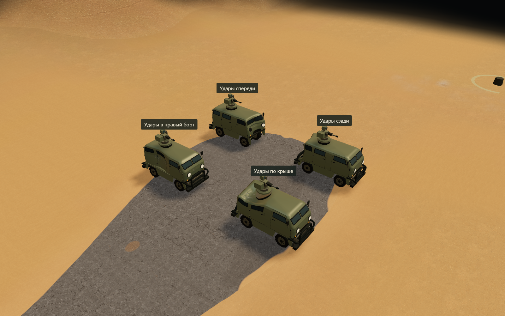

# Разная история ударов — разная геометрия

Исправлена ошибка предыдущего прототипа: обнуление HP больше не выбирает отсутствующие детали по ID/числу попаданий, не удаляет оружие и не добавляет одинаковый нагар. Конечного разрушенного меша нет. Сохраняется исходная сборка B01/C01/U01 с индивидуальным накопленным полем деформации и состояниями креплений.



Сценарий использует реальную кампанию и её renderer. Четырём одинаковым машинам передаются по три контакта `collision` мощностью 150, всего 450 HP. Отличаются только координаты и направление лучей. Все контакты проходят через обычные `damage.trace` и `Mission.damage`; все четыре машины достигают 0 HP.

| История | Наблюдаемый результат |
| --- | --- |
| Спереди | Смята передняя область; разрушены правая фара, передняя защита, лобовое остекление, правое зеркало и стекло кабины |
| В правый борт | Локально смята боковина; разрушены среднее и заднее правые окна |
| Сзади | Смята задняя область; разрушено заднее остекление и правое заднее боковое окно |
| По крыше | Продавлена задняя часть крыши; повреждено близкое к ней остекление |

Во всех четырёх случаях оружие остаётся на месте, нагар равен нулю. Различия подтверждены разными массивами смещений решётки, а не только рисунком отметин. Контрольная проверка ядра отдельно подтверждает равенство результатов для одинаковых контактов при разных ID машины.

Крупные планы: [борт](images/history-side.png), [крыша](images/history-roof.png), [передняя область](images/history-front.png), [задняя область](images/history-rear.png). Состояния, точные контакты и SHA-256 решёток: [individuality.json](measurements/individuality.json).

Это проверка четырёх входных последовательностей, не каталог четырёх вариантов разрушения. В самой игре точки контакта произвольные; сохранённая решётка накапливает их вклад. Выборки в сцене нужны только для воспроизводимого визуального сравнения.

```powershell
node tools/check-damage.mjs
node tools/check-damage-surface.mjs
node tools/check-damage-browser.mjs --individuality
```

Для исходного GLB после боковых ударов дополнительно проверены 526 треугольников среднего правого окна LOD0 и 242 LOD1: пересечений с оболочкой глубже 1 мм нет. Сетка уплотняется только при подготовке общего прототипа. В самой проверке четырёх историй обновлений позиционных буферов после попаданий — 0, вмятины отображаются GPU.

Ограничения сохраняются: двери пока часть общей оболочки, за окнами нет интерьера, разрыва произвольной топологии и симуляции складок тонкого листа нет. Эти эффекты не считаются готовыми. Расчёт локальной нагрузки и пластической решётки — собственная приближённая модель для RTS, а не восстановленный runtime-алгоритм FlatOut 2.
