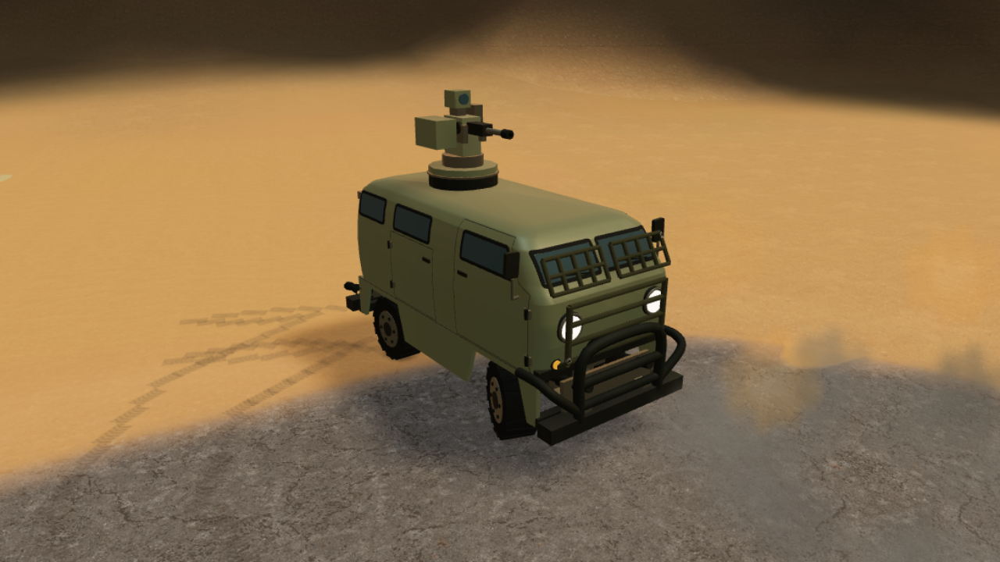

# Обломки и полевые модификации

Автоматический подбор включён по умолчанию. В конструкторе его можно отключить и выбрать известные рецепты. Совместимая своя живая машина должна коснуться детали корпусом: один предмет расходуется на одну модификацию. Приказ движения прямо к детали выбирает безопасный подъезд и завершающий манёвр. Доработка появляется на машине, повреждается отдельно и входит в сохранение.

При клике по артефакту из выделения назначается **одна ближайшая доступная машина**. Для пригодной детали сначала исключаются несовместимые машины, источник собственной детали и машины с уже установленными подходящими улучшениями; учитываются чертежи и выбранные в конструкторе рецепты. Затем выбирается ближайший получатель с доступным маршрутом. Если ближайший заперт, проверяется следующий. Если подходящих получателей или маршрутов нет, приказ отклоняется без движения остальных.

Повторный клик по тому же предмету сохраняет действующего сборщика и его маршрут. Остальные выбранные машины сохраняют свои задачи; старые дублирующие приказы к этому же предмету отменяются. При смене выделения новый успешный приказ может передать подбор другой машине, но два сборщика одновременно не назначаются. Один звук подтверждения относится к назначенной машине. Подбор работает и при включённом постоянном режиме кнопки «Атака», сохраняя сам режим.

Назначение хранится в задаче машины (`artifactId` / `salvageId`) и переживает сохранение. Деталь, явно назначенная получателю, не расходуется на случайно проезжающую машину. Stop, другой приказ или гибель получателя освобождают её для обычного автоматического подбора. Исчезновение предмета, отключение монтажа или установка нужного улучшения другим способом отменяют оставшийся приказ подбора. Машина, уже коснувшаяся падающей детали, ждёт окончания падения без повторной парковки. Прежний автоматический монтаж при случайном наезде на неназначенную деталь сохраняется.

| Объект | Срок жизни | Бюджет |
| --- | --- | --- |
| Обычные косметические обломки | 35 секунд или вытеснение | 64 существующих, до 24 в движении |
| Пригодные защитные конструкции | 240 игровых секунд или вытеснение старейшего | 24 на карту, без постоянной динамической физики |
| Остов автомобиля | 12 игровых секунд, последние 2 — растворение остатков | 64; до удаления сохраняет собственные повреждения и коллизию |
| Уничтоженное здание | 6 игровых секунд после взрыва | 32; затем освобождает строительство и навигацию |

Предметы извлекаются из исходных защитных конструкций C01 (parts 7/8), бамперов рейдера (7/8) и его дуг (24/25). При локальном отказе отделяется затронутая деталь; при гибели кузова освобождается ближайшее к смертельному попаданию сохранившееся пригодное крепление. Это правило не меняет поле вмятин и не выбирает готовый меш останков. Стекло, резина, сильно обгоревшие и размолотые воздействием мощнее 600 детали не дают запаса. Предмет появляется независимо от камеры, проходит короткую анимацию падения и доступен через 2 секунды. Источник не подбирает собственную деталь. Старейшие предметы вытесняются при превышении лимита.

Текущие рецепты для кузова B01:

- **Защита передка**, part 22: прочность 120, +120 к текущему и максимальному HP машины; прямое пулевое попадание в её геометрию передаёт корпусу 65% урона.
- **Решётки лобовых стёкол**, part 23: прочность 80, +80 к текущему и максимальному HP машины; прямое пулевое попадание передаёт 75% урона.

Бонусы складываются: у Буханки 320 → 440 → 520 максимального HP. Установка сохраняет прежний недостающий запас прочности корпуса. При разрушении модуля его бонус к максимуму снимается, текущий HP ограничивается новым максимумом без повторного начисления урона. Замена возвращает только бонус заменённой детали. При загрузке старого сохранения бонусы установленных целых модулей начисляются один раз; повторная загрузка не увеличивает HP, погибшая машина не оживает.

Попадание между прутьями достигает исходной поверхности и не получает эту защиту. Снаряды не получают пулевой коэффициент. При разрушении доработки её геометрия перестаёт участвовать в пересечении луча; следующий подходящий предмет может её заменить. Установленные элементы деформируются вместе с кузовом. Они созданы собственной геометрией в стиле текущей модели; исходные GLB не заменялись.

Оба чертежа стартовые (`gameplay.json → salvage.initialRecipes`). Для получения через исследование сценарий добавляет ID в `mission.state.salvage.recipes`; отдельная цепочка исследований не добавлена. Настройки и сроки сохраняются. Старые сохранения без срока удаления получают его однократно при загрузке. Модификации предназначены для реального B01; командный автомобиль с другим кузовом исключён из совместимости.

## Реализация и расширение

- [`vehicle-salvage.js`](../../campaign/vehicle-salvage.js): рецепты, сроки, ограниченный список, пространственный индекс и проверка пройденной ориентированной площади кузова. Проверка в логическом шаге не зависит от LOD.
- [`pickup-orders.js`](../../campaign/pickup-orders.js): выбор одного сборщика, проверка подхода, повторные приказы, освобождение назначения и ожидание окончания падения. Поиск подхода использует существующие коллизии и бюджетируемые генераторы навигации.
- [`salvage-layer.js`](../../campaign/salvage-layer.js): общая геометрия реальных снятых деталей, размещение по опорным точкам рельефа, отсечение по разведке/дальности. Сохранённые пригодные предметы статичны; для них нет отдельного rigid body.
- [`field-modification-models.js`](../../campaign/field-modification-models.js): две новые навесные конструкции, общий instanced batch на тип, `installationPart` исключает неустановленные детали из collider.
- [`damage-contact.js`](../../campaign/damage-contact.js): порождение пригодной детали при локальном отказе крепления. [`mission.js`](../../campaign/mission.js): локальный коэффициент защиты и обновление подбора.

Новый рецепт требует собственной геометрии, уникального damage part, профиля прочности, совместимости кузова и типа пригодного материала. Новая броня не должна автоматически распространять защиту на всю машину. Ручная буксировка, склад и свободное размещение навесной брони здесь не реализованы.

## Проверка

`npm run check:salvage` проверяет сроки/лимиты, обязательность чертежа и настройки, совместимость, пересечение пути, сохранение, однократное расходование, замену сломанной детали, настоящий collider и локальную защиту.

`npm run check:pickup` — 9 проверок: выбор ближайшего, соседние предметы, уже установленный модуль, отсутствие рецепта, единственный получатель между выделениями, сохранение и Stop, удаление устаревшей задачи, ожидание падения, старые дублирующие маршруты и запертая ближайшая машина. `node tools/check-pickup-browser.mjs` (`WARGAME_URL`) проверяет реальные клики и движение на рельефе кампании, повторные клики с включённой кнопкой «Атака», установку и отсутствие движения остальных восьми машин. Скриншоты снимаются при 1920×1080 и 800×900; [отчёт](../../campaign/reports/pickup-browser.json), [подобранный артефакт](../../campaign/previews/pickup/artifact-collected.png), [установленный модуль](../../campaign/previews/pickup/module-installed.png). Полная миссия после этого изменения завершилась победой на 905,7 игровой секунде; строительство, ремонт и исследования прошли проверку. Это функциональные тесты, не замер FPS.

`node tools/check-damage-browser.mjs --salvage` проверяет реальный подъезд рядом с твёрдым остовом, установку parts 22/23, попадания и настройку конструктора. Пуля мощностью 8 снимает соответственно 5,2 и 6 HP. Последние измеренные шаги движения находятся в `campaign/reports/salvage-smoke.json`.

`--destruction` проверяет взрыв, отделение существующих крыш, удаление лагеря, начало новой стройки на том же месте, удаление рейдера и подбор его детали. Это функциональные сценарии, не FPS-бенчмарк. Полного произвольного дробления бетонных стен нет.

