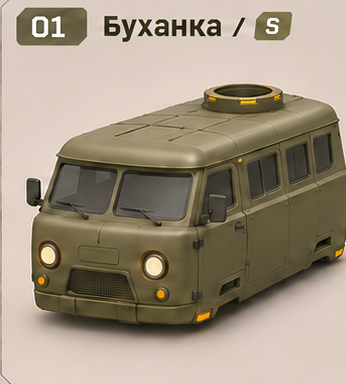
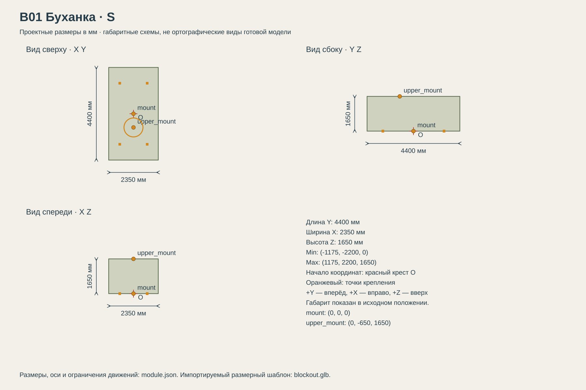

# B01 Буханка

Дешёвая служебная машина под разведку и лёгкую поддержку.

## Размеры и крепления

**Размеры назначены для игры и обязательны для модели.** Концепт показывает внешний характер; численные размеры задаются здесь и в module.json, а не измеряются по пикселям.

| Параметр | Значение |
| --- | --- |
| Класс | S |
| Длина Y | 4400 мм |
| Ширина X | 2350 мм |
| Высота Z | 1650 мм |
| Min X Y Z | (-1175, -2200, 0) мм |
| Max X Y Z | (1175, 2200, 1650) мм |
| Оси | +X вправо, +Y вперёд, +Z вверх |
| Масштаб | 1000 мм = 1 м; GLB хранит метры |
| Начало координат | Центр нижней монтажной плоскости Z=0; ставится на body_mount ходовой. |
| mount | (0, 0, 0) мм; нижняя монтажная плоскость |
| upper_mount | (0, -650, 1650) мм; верхняя контактная плоскость кольца |
| pad_FL | (-650, 1450, 0) мм; центр площадки 180 × 180 мм |
| pad_FR | (650, 1450, 0) мм; центр площадки 180 × 180 мм |
| pad_RL | (-650, -1450, 0) мм; центр площадки 180 × 180 мм |
| pad_RR | (650, -1450, 0) мм; центр площадки 180 × 180 мм |
| Диаметр верхнего интерфейса | 900 мм |
| Высота фланца верхнего модуля | 80 мм над его нулевой плоскостью |

[Открыть размерную заготовку GLB](blockout.glb). Это габаритный объём и пустые узлы креплений/движений; художественной геометрии и готовых анимаций в нём нет.

## Внешний вид

Округлые плечи крыши и выпуклый нос по фотографиям пользователя; общий пояс окон, наклонный проём передних дверей, круглые фары в ободках, трапециевидная сетчатая решётка. Арки принадлежат C01. Внешняя ширина 2350 мм включает зеркала, ширина основной оболочки 1950 мм.

## Подвижные части

Все центры ниже заданы в координатах всего модуля при исходной позе, в мм. Оси вращения заданы в локальной системе родителя. Положительное вращение — по правилу правой руки.

Корпус неподвижен. Панели, окна, экраны и посадочные кольца не анимируются. Вращение установленного верхнего модуля относится к его собственной модели.

## Состояния и последовательность анимаций

- **Выключен:** Корпус неподвижен, подсветка выключена.
- **Движение:** Геометрия неподвижна относительно body_mount. Работают только перечисленные фары и габариты.
- **Повреждён:** Не менять размеры и сокеты. Повреждение — материал и отдельные эффекты; отсоединение экранов в стартовой версии не предусмотрено.

## Светящиеся элементы

Цвета указаны в sRGB HEX. Strength — условная безразмерная сила Emission для художественного материала. Это не освещённость в люменах. Отдельные источники света не добавлять, если они не перечислены.

| Материал или узел | Центр X Y Z мм | Цвет | Strength | Когда работает |
| --- | --- | --- | --- | --- |
| headlamp_L | (-620, 2180, 560) | #FFD9A0 | 4 | Фары выключены: Emission=0; включены: 4. Световой конус направлен вперёд и немного вниз. |
| headlamp_R | (620, 2180, 560) | #FFD9A0 | 4 | Фары выключены: Emission=0; включены: 4. Световой конус направлен вперёд и немного вниз. |
| rear_marker_L | (-770, -2110, 350) | #FF4938 | 2.2 | При включённых габаритах Emission=2.2; при выключенных 0.15. Красная секция находится в общем чёрном корпусе с жёлтым и светлым сегментами. |
| rear_marker_R | (770, -2110, 350) | #FF4938 | 2.2 | При включённых габаритах Emission=2.2; при выключенных 0.15. Красная секция находится в общем чёрном корпусе с жёлтым и светлым сегментами. |

## Зазоры и ограничения

- Верх оболочки не выше 1500 мм, контактное кольцо на Z=1650. Полный габарит включает зеркала; нижнее посадочное пятно 4200 × 1950 мм.
- Ни одна часть корпуса не опускается ниже Z=0. Площадки и центр нижнего интерфейса не смещать ради внешнего силуэта.
- Двери, панели и окна в стартовой версии статичны: отдельной анимации экипажа нет. Не добавлять самопроизвольное вращение кольца.
- Светящиеся элементы не выступают за габариты. Линзы камер имеют материал стекла и не являются прожекторами.
- Оконные рамки и стекло повторяют ту же поверхность оболочки; общая высота окон от Z=970 до Z=1310 мм. Толщина окантовки 35 мм.
- Швы дверей повторяют кривизну боковин; номинальная ширина 3.6 мм. Петли пересекают шов, а не висят на одной половине двери.
- Основная оболочка и все детали дверей — один независимый модуль B01. Крылья, арки и бамперы не включать в его меш.

## Игровые модели

- [LOD0](../../../assets/vehicles/B01/B01-lod0.glb)
- [LOD1](../../../assets/vehicles/B01/B01-lod1.glb)
- [LOD2](../../../assets/vehicles/B01/B01-lod2.glb)

## Фотографии для формы и материала

- [Оливковая краска и боковина](photos/olive-side.png)
- [Форма кузова и арок](photos/winter-side.png)
- [Проёмы и детали борта](photos/camo-side.png)
- [Лобовые стёкла, нос, фары и решётка](photos/front-quarter.png)

## Файлы

- `reference.png` — отдельный фрагмент исходного концепта без перерисовки.
- `dimensions.svg` — три вида габаритного объёма в одном масштабе, с размерами и центрами креплений.
- `module.json` — источник размеров, узлов, состояний и подсветки.
- `blockout.glb` — размерный шаблон для импорта в 3D-редактор.

[Единый стандарт размеров](../../standards.md) · [Каталог](../../../README.md)
