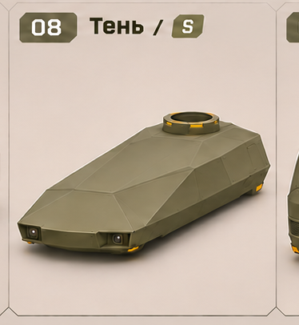
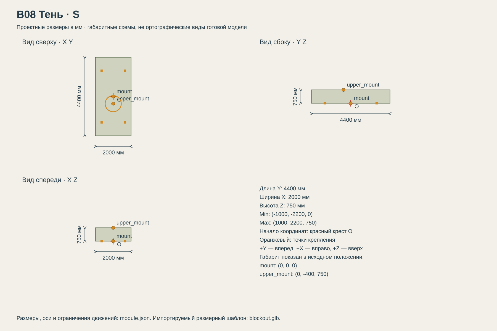

# B08 Тень

Скрытная разведка и обходные действия.

## Размеры и крепления

**Размеры назначены для игры и обязательны для модели.** Концепт показывает внешний характер; численные размеры задаются здесь и в module.json, а не измеряются по пикселям.

| Параметр | Значение |
| --- | --- |
| Класс | S |
| Длина Y | 4400 мм |
| Ширина X | 2000 мм |
| Высота Z | 750 мм |
| Min X Y Z | (-1000, -2200, 0) мм |
| Max X Y Z | (1000, 2200, 750) мм |
| Оси | +X вправо, +Y вперёд, +Z вверх |
| Масштаб | 1000 мм = 1 м; GLB хранит метры |
| Начало координат | Центр нижней монтажной плоскости Z=0; ставится на body_mount ходовой. |
| mount | (0, 0, 0) мм; нижняя монтажная плоскость |
| upper_mount | (0, -400, 750) мм; верхняя контактная плоскость кольца |
| pad_FL | (-650, 1450, 0) мм; центр площадки 180 × 180 мм |
| pad_FR | (650, 1450, 0) мм; центр площадки 180 × 180 мм |
| pad_RL | (-650, -1450, 0) мм; центр площадки 180 × 180 мм |
| pad_RR | (650, -1450, 0) мм; центр площадки 180 × 180 мм |
| Диаметр верхнего интерфейса | 900 мм |
| Высота фланца верхнего модуля | 80 мм над его нулевой плоскостью |

[Открыть размерную заготовку GLB](blockout.glb). Это габаритный объём и пустые узлы креплений/движений; художественной геометрии и готовых анимаций в нём нет.

## Внешний вид

Гладкий низкий силуэт, слитные наклонные панели и утопленные камеры. Сниженная заметность является игровой характеристикой; защита слабее тяжёлых корпусов.

## Подвижные части

Все центры ниже заданы в координатах всего модуля при исходной позе, в мм. Оси вращения заданы в локальной системе родителя. Положительное вращение — по правилу правой руки.

Корпус неподвижен. Панели, окна, экраны и посадочные кольца не анимируются. Вращение установленного верхнего модуля относится к его собственной модели.

## Состояния и последовательность анимаций

- **Выключен:** Корпус неподвижен, подсветка выключена.
- **Движение:** Геометрия неподвижна относительно body_mount. Работают только перечисленные фары и габариты.
- **Повреждён:** Не менять размеры и сокеты. Повреждение — материал и отдельные эффекты; отсоединение экранов в стартовой версии не предусмотрено.

## Светящиеся элементы

Цвета указаны в sRGB HEX. Strength — условная безразмерная сила Emission для художественного материала. Это не освещённость в люменах. Отдельные источники света не добавлять, если они не перечислены.

| Материал или узел | Центр X Y Z мм | Цвет | Strength | Когда работает |
| --- | --- | --- | --- | --- |
| rear_marker_L | (-700, -2170, 250) | #FF4938 | 0.7 | Габарит 0.25; торможение 0.7; при выключенной машине 0. |
| rear_marker_R | (700, -2170, 250) | #FF4938 | 0.7 | Габарит 0.25; торможение 0.7; при выключенной машине 0. |

## Зазоры и ограничения

- Геометрия корпуса, кроме посадочного кольца, заканчивается не выше Z=570 мм. Верхняя контактная плоскость Z=750 мм; 180 мм отделяют её от обвеса.
- Ни одна часть корпуса не опускается ниже Z=0. Площадки и центр нижнего интерфейса не смещать ради внешнего силуэта.
- Двери, панели и окна в стартовой версии статичны: отдельной анимации экипажа нет. Не добавлять самопроизвольное вращение кольца.
- Светящиеся элементы не выступают за габариты. Линзы камер имеют материал стекла и не являются прожекторами.

## Файлы

- `reference.png` — отдельный фрагмент исходного концепта без перерисовки.
- `dimensions.svg` — три вида габаритного объёма в одном масштабе, с размерами и центрами креплений.
- `module.json` — источник размеров, узлов, состояний и подсветки.
- `blockout.glb` — размерный шаблон для импорта в 3D-редактор.

[Единый стандарт размеров](../../standards.md) · [Каталог](../../../README.md)
