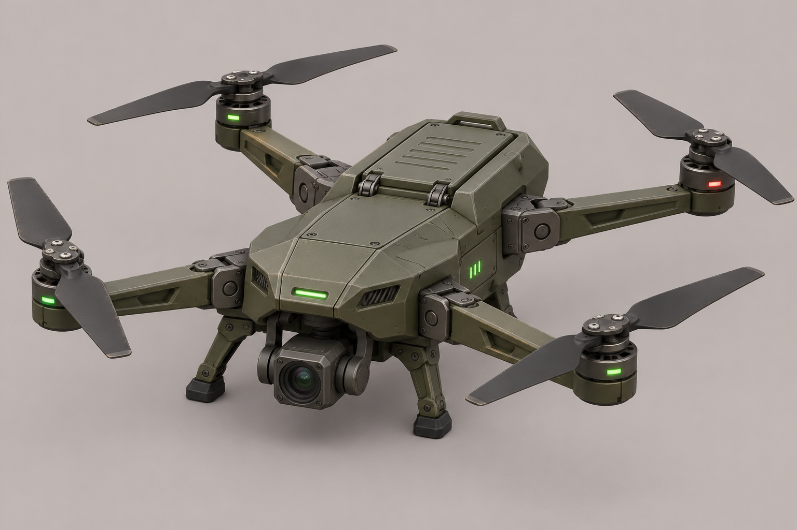
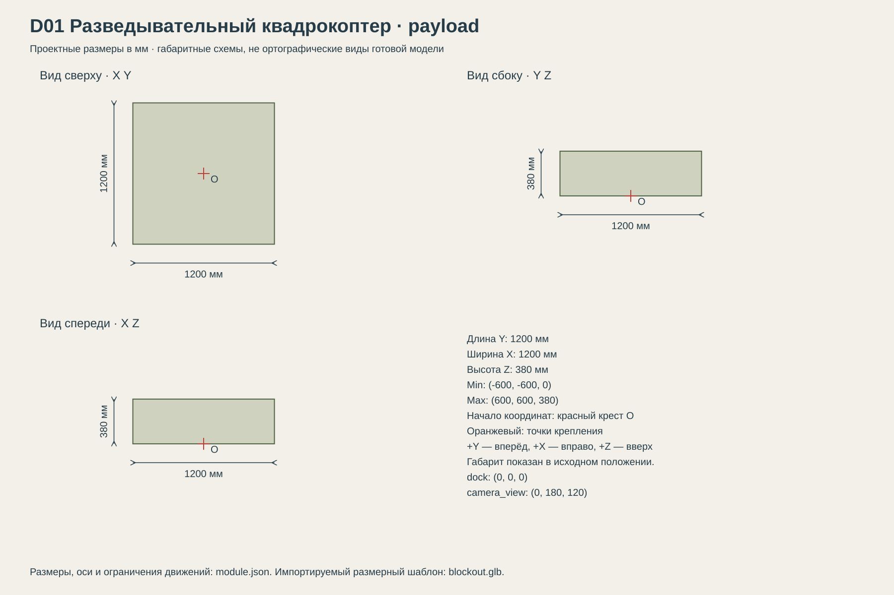

# D01 Разведывательный квадрокоптер

Воздушная разведка; отдельный объект носителя U22.

## Размеры и крепления

**Размеры назначены для игры и обязательны для модели.** Концепт показывает внешний характер; численные размеры задаются здесь и в module.json, а не измеряются по пикселям.

| Параметр | Значение |
| --- | --- |
| Класс | payload |
| Длина Y | 1200 мм |
| Ширина X | 1200 мм |
| Высота Z | 380 мм |
| Min X Y Z | (-600, -600, 0) мм |
| Max X Y Z | (600, 600, 380) мм |
| Оси | +X вправо, +Y вперёд, +Z вверх |
| Масштаб | 1000 мм = 1 м; GLB хранит метры |
| Начало координат | Центр проекции дрона на опорную поверхность; Z=0 — низ посадочных опор. |
| dock | (0, 0, 0) мм; совмещается с drone_slot носителя |
| camera_view | (0, 180, 120) мм; начало обзора; следует подвесу |
| Транспортный габарит Д × Ш × В | 620 × 460 × 280 мм |

[Открыть размерную заготовку GLB](blockout.glb). Это габаритный объём и пустые узлы креплений/движений; художественной геометрии и готовых анимаций в нём нет.

## Внешний вид

Оливковый плоский корпус, четыре складных луча, четыре двухлопастных ротора, нижняя камера на подвесе и четыре посадочные опоры.

## Подвижные части

Все центры ниже заданы в координатах всего модуля при исходной позе, в мм. Оси вращения заданы в локальной системе родителя. Положительное вращение — по правилу правой руки.

| Узел | Родитель | Центр X Y Z мм | Движение | Пределы или скорость |
| --- | --- | --- | --- | --- |
| arm_1 | корень модуля | (-140, 160, 240) | rotation по Z. 0 — раскрытый луч, крайний угол — сложенный. Лопасти складываются отдельно перед уборкой луча. | 0…90 градусов, 112.5 град/с; 0 — раскрыта |
| rotor_1 | arm_retract_1 | (-430, 430, 260) | rotation по Z. Радиус 170 мм; две лопасти. | непрерывное вращение; 2400 град/с |
| blade_fold_1 | rotor_1 | (-430, 430, 260) | Одна лопасть поворачивается к другой: 180° — обе параллельны. Перед складыванием ротор паркуется вдоль +Y. | 0…180 градусов; складывание 0.8 с |
| arm_2 | корень модуля | (140, 160, 240) | rotation по Z. 0 — раскрытый луч, крайний угол — сложенный. Лопасти складываются отдельно перед уборкой луча. | -90…0 градусов, 112.5 град/с; 0 — раскрыта |
| rotor_2 | arm_retract_2 | (430, 430, 260) | rotation по Z. Радиус 170 мм; две лопасти. | непрерывное вращение; -2400 град/с |
| blade_fold_2 | rotor_2 | (430, 430, 260) | Одна лопасть поворачивается к другой: 180° — обе параллельны. Перед складыванием ротор паркуется вдоль +Y. | 0…180 градусов; складывание 0.8 с |
| arm_3 | корень модуля | (-140, -160, 240) | rotation по Z. 0 — раскрытый луч, крайний угол — сложенный. Лопасти складываются отдельно перед уборкой луча. | -90…0 градусов, 112.5 град/с; 0 — раскрыта |
| rotor_3 | arm_retract_3 | (-430, -430, 260) | rotation по Z. Радиус 170 мм; две лопасти. | непрерывное вращение; -2400 град/с |
| blade_fold_3 | rotor_3 | (-430, -430, 260) | Одна лопасть поворачивается к другой: 180° — обе параллельны. Перед складыванием ротор паркуется вдоль +Y. | 0…180 градусов; складывание 0.8 с |
| arm_4 | корень модуля | (140, -160, 240) | rotation по Z. 0 — раскрытый луч, крайний угол — сложенный. Лопасти складываются отдельно перед уборкой луча. | 0…90 градусов, 112.5 град/с; 0 — раскрыта |
| rotor_4 | arm_retract_4 | (430, -430, 260) | rotation по Z. Радиус 170 мм; две лопасти. | непрерывное вращение; 2400 град/с |
| blade_fold_4 | rotor_4 | (430, -430, 260) | Одна лопасть поворачивается к другой: 180° — обе параллельны. Перед складыванием ротор паркуется вдоль +Y. | 0…180 градусов; складывание 0.8 с |
| camera_yaw | корень модуля | (0, 160, 140) | rotation по Z.  | -160…160 градусов; исходное 0; 90 град/с |
| camera_pitch | camera_yaw | (0, 180, 120) | rotation по X.  | -90…30 градусов; исходное 0; 60 град/с |
| landing_foot_1 | корень модуля | (-120, 140, 120) | 0 — опора выпущена; 80 — сложена к корпусу. Левая/правая геометрия зеркальна, ось в каждом узле направлена от центра наружу. | 0…80 градусов, 160 град/с; складывание 0.5 с |
| landing_foot_2 | корень модуля | (120, 140, 120) | 0 — опора выпущена; 80 — сложена к корпусу. Левая/правая геометрия зеркальна, ось в каждом узле направлена от центра наружу. | 0…80 градусов, 160 град/с; складывание 0.5 с |
| landing_foot_3 | корень модуля | (-120, -140, 120) | 0 — опора выпущена; 80 — сложена к корпусу. Левая/правая геометрия зеркальна, ось в каждом узле направлена от центра наружу. | 0…80 градусов, 160 град/с; складывание 0.5 с |
| landing_foot_4 | корень модуля | (120, -140, 120) | 0 — опора выпущена; 80 — сложена к корпусу. Левая/правая геометрия зеркальна, ось в каждом узле направлена от центра наружу. | 0…80 градусов, 160 град/с; складывание 0.5 с |
| arm_retract_1 | arm_1 | (-140, 160, 240) | Телескопическое втягивание луча к шарниру перед складыванием. Ось задана axis_vector. | -320…0 мм; 0.6 с на полный ход |
| arm_retract_2 | arm_2 | (140, 160, 240) | Телескопическое втягивание луча к шарниру перед складыванием. Ось задана axis_vector. | -320…0 мм; 0.6 с на полный ход |
| arm_retract_3 | arm_3 | (-140, -160, 240) | Телескопическое втягивание луча к шарниру перед складыванием. Ось задана axis_vector. | -320…0 мм; 0.6 с на полный ход |
| arm_retract_4 | arm_4 | (140, -160, 240) | Телескопическое втягивание луча к шарниру перед складыванием. Ось задана axis_vector. | -320…0 мм; 0.6 с на полный ход |

## Состояния и последовательность анимаций

- **Хранение:** Лопасти 180°, лучи втянуты на 320 мм и сложены до крайних углов, опоры 80°, камера 0. Роторы остановлены; их парковочный угол противоположен углу шарнира луча. Транспортный габарит 620 × 460 × 280 мм.
- **Раскрытие:** В точке запуска раскрыть шарниры в 0 за 0.8 с, одновременно компенсируя угол ротора. Выдвинуть лучи -320→0 за 0.6 с. Раскрыть лопасти 180→0 за 0.8 с, опоры 80→0 за 0.5 с; затем включить роторы.
- **Полёт:** Раскрутка роторов за 0.5 с до ±2400 град/с. Камера вращается независимо. Максимальный визуальный наклон всего дрона ±20°; это движение игрового объекта.
- **Возврат:** После захвата остановить роторы за 0.5 с и припарковать вдоль +Y. Камера 0; сложить опоры за 0.5 с, лопасти за 0.8 с, втянуть лучи на 320 мм за 0.6 с, затем сложить шарниры за 0.8 с. При складывании угол ротора = -угол шарнира: лопасти остаются ориентированы вдоль Y.

## Светящиеся элементы

Цвета указаны в sRGB HEX. Strength — условная безразмерная сила Emission для художественного материала. Это не освещённость в люменах. Отдельные источники света не добавлять, если они не перечислены.

| Материал или узел | Центр X Y Z мм | Цвет | Strength | Когда работает |
| --- | --- | --- | --- | --- |
| navigation_1 | (-430, 430, 230) | #E85145 | 0.7 | Постоянный навигационный свет в полёте; в хранении 0. |
| navigation_2 | (430, 430, 230) | #75D58A | 0.7 | Постоянный навигационный свет в полёте; в хранении 0. |
| navigation_3 | (-430, -430, 230) | #E85145 | 0.7 | Постоянный навигационный свет в полёте; в хранении 0. |
| navigation_4 | (430, -430, 230) | #75D58A | 0.7 | Постоянный навигационный свет в полёте; в хранении 0. |

## Зазоры и ограничения

- Рабочий габарит 1200 × 1200 × 380 мм; транспортный 620 × 460 × 280 мм. Складную геометрию проектировать под транспортный габарит, он имеет приоритет над картинкой.
- Четыре ротора, четыре луча; видимые на концепте дополнительные шарниры не превращать в дополнительные двигатели.
- Камера не светится; линза — стекло. Дрон не несёт оружие в стартовом наборе.
- Навигационные цвета на концепте условные; схема материалов и стороны определены в module.json.
- В транспортной позе центры роторов X≈±191.2, Y≈±104.2 мм; мотор радиусом 30 мм и сложенная лопасть длиной 170 мм укладываются в транспортный габарит. Полные поверхности и траектории необходимо проверить на художественной модели.

## Файлы

- `reference.png` — отдельный фрагмент исходного концепта без перерисовки.
- `dimensions.svg` — три вида габаритного объёма в одном масштабе, с размерами и центрами креплений.
- `module.json` — источник размеров, узлов, состояний и подсветки.
- `blockout.glb` — размерный шаблон для импорта в 3D-редактор.

[Единый стандарт размеров](../../standards.md) · [Каталог](../../../README.md)
