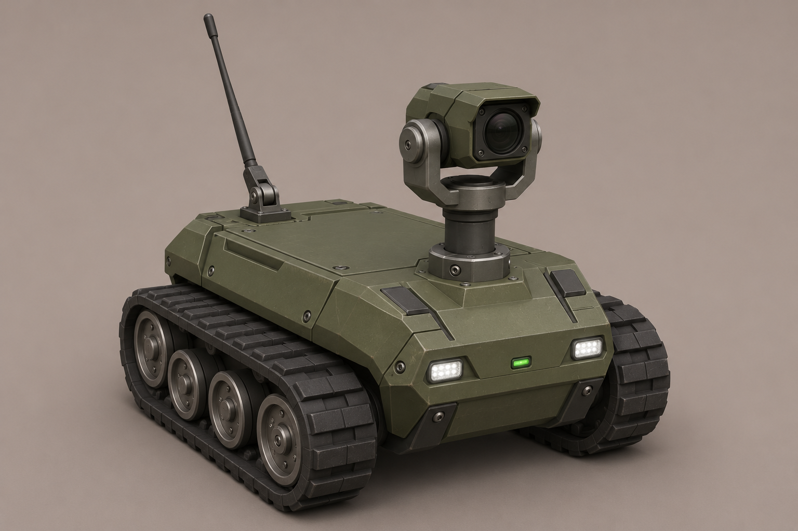
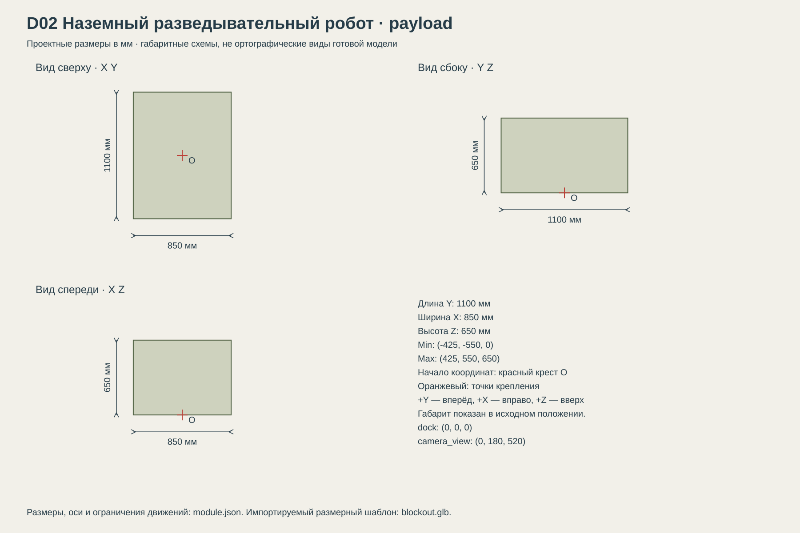

# D02 Наземный разведывательный робот

Наземная разведка и осмотр; два одинаковых независимых робота в носителе U23.

## Размеры и крепления

**Размеры назначены для игры и обязательны для модели.** Концепт показывает внешний характер; численные размеры задаются здесь и в module.json, а не измеряются по пикселям.

| Параметр | Значение |
| --- | --- |
| Класс | payload |
| Длина Y | 1100 мм |
| Ширина X | 850 мм |
| Высота Z | 650 мм |
| Min X Y Z | (-425, -550, 0) мм |
| Max X Y Z | (425, 550, 650) мм |
| Оси | +X вправо, +Y вперёд, +Z вверх |
| Масштаб | 1000 мм = 1 м; GLB хранит метры |
| Начало координат | Центр между гусеницами на земле; Z=0 — опорная поверхность. |
| dock | (0, 0, 0) мм; совмещается с robot_slot U23 |
| camera_view | (0, 180, 520) мм; начало обзора; следует камере |
| Рабочая область Min X Y Z | (-425, -550, 0) мм |
| Рабочая область Max X Y Z | (425, 550, 900) мм |
| Рабочая область | Консервативный объём для движений, не сплошной меш и не коллайдер |

[Открыть размерную заготовку GLB](blockout.glb). Это габаритный объём и пустые узлы креплений/движений; художественной геометрии и готовых анимаций в нём нет.

## Внешний вид

Небольшая гусеничная платформа с передней камерой на короткой мачте, компактными фарами и складной антенной. Без манипулятора и оружия.

## Подвижные части

Все центры ниже заданы в координатах всего модуля при исходной позе, в мм. Оси вращения заданы в локальной системе родителя. Положительное вращение — по правилу правой руки.

| Узел | Родитель | Центр X Y Z мм | Движение | Пределы или скорость |
| --- | --- | --- | --- | --- |
| track_L | корень модуля | (-335, 0, 150) | uv_scroll по Y. Лента шириной 180 мм; смещение UV = -путь/2400 mod 1. | непрерывное вращение |
| track_R | корень модуля | (335, 0, 150) | uv_scroll по Y. Правая лента, независимая скорость. | непрерывное вращение |
| camera_yaw | корень модуля | (0, 120, 480) | rotation по Z.  | -160…160 градусов; исходное 0; 60 град/с |
| camera_pitch | camera_yaw | (0, 180, 520) | rotation по X.  | -30…70 градусов; исходное 0; 45 град/с |
| antenna | корень модуля | (0, -300, 330) | rotation по X. 0 — сложена назад, 85 — поднята. | 0…85 градусов; исходное 0; 85 град/с |

## Состояния и последовательность анимаций

- **Хранение:** Антенна 0, камера в 0, ленты остановлены. Габарит совпадает с исходным.
- **Выгрузка:** По команде U23 движется 500 мм/с по аппарели; камера вперёд, антенна сложена.
- **Разведка:** Поднять антенну до 85 за 1 с. Камера работает независимо, ленты согласованы с путём каждой стороны; разворот на месте допустим.
- **Возврат:** Сложить антенну за 1 с, камера в 0. Подняться по аппарели, занять слот, остановить ленты.

## Светящиеся элементы

Цвета указаны в sRGB HEX. Strength — условная безразмерная сила Emission для художественного материала. Это не освещённость в люменах. Отдельные источники света не добавлять, если они не перечислены.

| Материал или узел | Центр X Y Z мм | Цвет | Strength | Когда работает |
| --- | --- | --- | --- | --- |
| headlamp_L | (-240, 500, 250) | #E4F0FF | 1 | Постоянно при включённых фарах. |
| headlamp_R | (240, 500, 250) | #E4F0FF | 1 | Постоянно при включённых фарах. |
| status | (0, -500, 300) | #75D58A | 0.7 | Работа: 0.7; зарядка в носителе: плавно 0.1…0.7 за 2 с; выключен 0. |

## Зазоры и ограничения

- Высота 650 мм включает сложенную антенну и камеру; рабочая высота с поднятой антенной не более 900 мм.
- Ленты шириной 180 мм, центры X=±335, длина платформы 1100 мм. Полная ширина 850 мм — под проход аппарели 1200 мм.
- Каждый экземпляр имеет собственные состояния и управление; не объединять двух роботов в один меш.

## Файлы

- `reference.png` — отдельный фрагмент исходного концепта без перерисовки.
- `dimensions.svg` — три вида габаритного объёма в одном масштабе, с размерами и центрами креплений.
- `module.json` — источник размеров, узлов, состояний и подсветки.
- `blockout.glb` — размерный шаблон для импорта в 3D-редактор.

[Единый стандарт размеров](../../standards.md) · [Каталог](../../../README.md)
