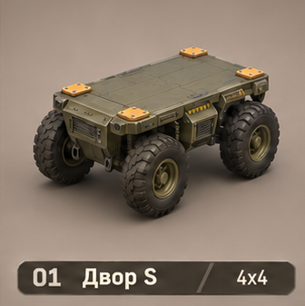
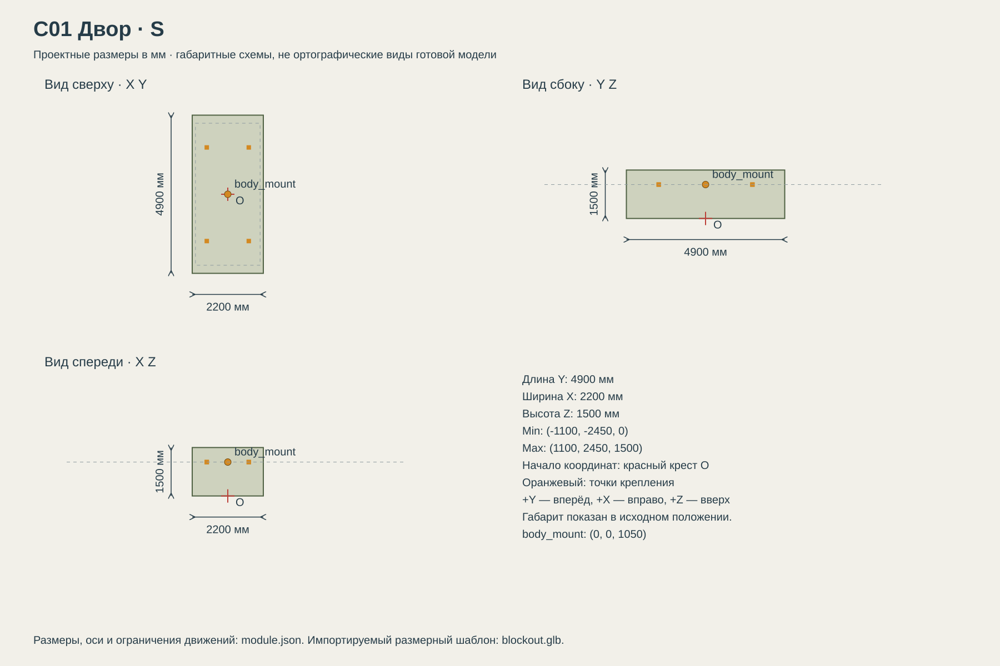

# C01 Двор

Дешёвая мобильность для ранней разведки и служебных машин; ограниченная проходимость на тяжёлом грунте.

## Размеры и крепления

**Размеры назначены для игры и обязательны для модели.** Концепт показывает внешний характер; численные размеры задаются здесь и в module.json, а не измеряются по пикселям.

| Параметр | Значение |
| --- | --- |
| Класс | S |
| Длина Y | 4900 мм |
| Ширина X | 2200 мм |
| Высота Z | 1500 мм |
| Min X Y Z | (-1100, -2450, 0) мм |
| Max X Y Z | (1100, 2450, 1500) мм |
| Оси | +X вправо, +Y вперёд, +Z вверх |
| Масштаб | 1000 мм = 1 м; GLB хранит метры |
| Начало координат | Центр машины на земле: Z=0 — опорная поверхность в исходной позе. |
| body_mount | (0, 0, 1050) мм; центр контактной плоскости палубы |
| pad_FL | (-650, 1450, 1050) мм; центр площадки 180 × 180 мм |
| pad_FR | (650, 1450, 1050) мм; центр площадки 180 × 180 мм |
| pad_RL | (-650, -1450, 1050) мм; центр площадки 180 × 180 мм |
| pad_RR | (650, -1450, 1050) мм; центр площадки 180 × 180 мм |
| Рабочая область Min X Y Z | (-1200, -2450, -80) мм |
| Рабочая область Max X Y Z | (1200, 2450, 1550) мм |
| Рабочая область | Консервативный объём для движений, не сплошной меш и не коллайдер |

[Открыть размерную заготовку GLB](blockout.glb). Это габаритный объём и пустые узлы креплений/движений; художественной геометрии и готовых анимаций в нём нет.

## Внешний вид

Компактная ходовая 4×4: колея 1400 мм, база 2600 мм, четыре шины диаметром 900 мм. Мосты, рессоры и амортизаторы видимо соединяют колёса с рамой. Формованные колёсные арки, передняя и задняя защита являются геометрией C01.

## Подвижные части

Все центры ниже заданы в координатах всего модуля при исходной позе, в мм. Оси вращения заданы в локальной системе родителя. Положительное вращение — по правилу правой руки.

| Узел | Родитель | Центр X Y Z мм | Движение | Пределы или скорость |
| --- | --- | --- | --- | --- |
| sprung_frame | корень модуля | (0, 0, 0) | Подрессоренная рама; вместе с ней движутся арки, body_mount и весь установленный B+U. Колёса остаются в неподрессоренной части C01. | Z ±8 мм; pitch X ±0.008 рад (0.458°), roll Y ±0.010 рад (0.573°). Оси колёс не качаются вместе с рамой. |
| axle_1_L_suspension | корень модуля | (-700, 1300, 450) | translation по Z. Ход подвески относительно исходного центра. | -80…80 мм; исходное 0; 250 мм/с |
| axle_1_L_steer | axle_1_L_suspension | (-700, 1300, 450) | rotation по Z. Только управляемая ось. | -35…35 градусов; исходное 0; 60 град/с |
| axle_1_L_wheel | axle_1_L_steer | (-700, 1300, 450) | rotation по X. Угол = -пройденный путь / 450 радиан; одинаковая ось +X у левого и правого колеса. | непрерывное вращение |
| axle_1_R_suspension | корень модуля | (700, 1300, 450) | translation по Z. Ход подвески относительно исходного центра. | -80…80 мм; исходное 0; 250 мм/с |
| axle_1_R_steer | axle_1_R_suspension | (700, 1300, 450) | rotation по Z. Только управляемая ось. | -35…35 градусов; исходное 0; 60 град/с |
| axle_1_R_wheel | axle_1_R_steer | (700, 1300, 450) | rotation по X. Угол = -пройденный путь / 450 радиан; одинаковая ось +X у левого и правого колеса. | непрерывное вращение |
| axle_2_L_suspension | корень модуля | (-700, -1300, 450) | translation по Z. Ход подвески относительно исходного центра. | -80…80 мм; исходное 0; 250 мм/с |
| axle_2_L_wheel | axle_2_L_suspension | (-700, -1300, 450) | rotation по X. Угол = -пройденный путь / 450 радиан; одинаковая ось +X у левого и правого колеса. | непрерывное вращение |
| axle_2_R_suspension | корень модуля | (700, -1300, 450) | translation по Z. Ход подвески относительно исходного центра. | -80…80 мм; исходное 0; 250 мм/с |
| axle_2_R_wheel | axle_2_R_suspension | (700, -1300, 450) | rotation по X. Угол = -пройденный путь / 450 радиан; одинаковая ось +X у левого и правого колеса. | непрерывное вращение |

## Состояния и последовательность анимаций

- **Стоянка:** Рулевые узлы 0, ход подвески 0. Вращение колёс остановлено.
- **Езда:** Вращение колёс определяется фактическим пройденным путём, не произвольной частотой. Подвеска следует грунту в своих пределах.
- **Поворот:** Управляемые колёса поворачиваются вокруг Z, остальные остаются по направлению корпуса. У второй управляемой оси угол 70% первой. Для внутреннего и внешнего колеса применяется разница углов без выхода за пределы.
- **Торможение:** Частота вращения уменьшается вместе со скоростью движения; не останавливать колёса до остановки машины.
- **Качание на ходу:** В демо θ — угол кругового маршрута: Z=8 sin(31θ) мм; pitch=0.008 sin(26θ) рад; roll=0.010 sin(19θ+0.7) рад. Плавный подход с коэффициентом 8 с⁻¹. На стоянке возврат к 0. Это художественное движение рамы, не физический расчёт подвески.

## Светящиеся элементы

Цвета указаны в sRGB HEX. Strength — условная безразмерная сила Emission для художественного материала. Это не освещённость в люменах. Отдельные источники света не добавлять, если они не перечислены.

Собственных светящихся элементов нет. Оранжевые метки крепления — краска, не подсветка.

## Зазоры и ограничения

- Монтажная плоскость на Z=1050 мм. Рама, арки и защитные дуги C01 отделяются вместе при разборке; наружные дуги находятся вне центрального посадочного пятна.
- Весь этот центральный прямоугольник выше монтажной плоскости свободен от собственной геометрии ходовой.
- Колёса, гусеницы и ноги не входят в объём установленного корпуса. Минимальный зазор до движущихся частей 150 мм.
- Оранжевые метки крепления — краска без Emission. Фары находятся на корпусе, не дублировать их на палубе.
- Арки следуют осям Y=±1300 и закрывают верх колёс. Стык с корпусом — тонкий посадочный буртик с уплотнением, не широкая декоративная полоса.
- При движении по кругу рама мягко качается, а колёса остаются на поверхности. Подвижный body_mount передаёт ту же трансформацию корпусу и верхнему модулю.

## Игровые модели

- [LOD0](../../../assets/vehicles/C01/C01-lod0.glb)
- [LOD1](../../../assets/vehicles/C01/C01-lod1.glb)
- [LOD2](../../../assets/vehicles/C01/C01-lod2.glb)

## Файлы

- `reference.png` — отдельный фрагмент исходного концепта без перерисовки.
- `dimensions.svg` — три вида габаритного объёма в одном масштабе, с размерами и центрами креплений.
- `module.json` — источник размеров, узлов, состояний и подсветки.
- `blockout.glb` — размерный шаблон для импорта в 3D-редактор.

[Единый стандарт размеров](../../standards.md) · [Каталог](../../../README.md)
