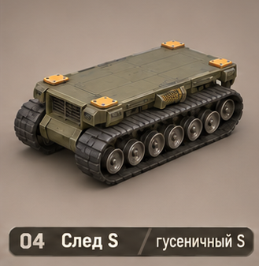
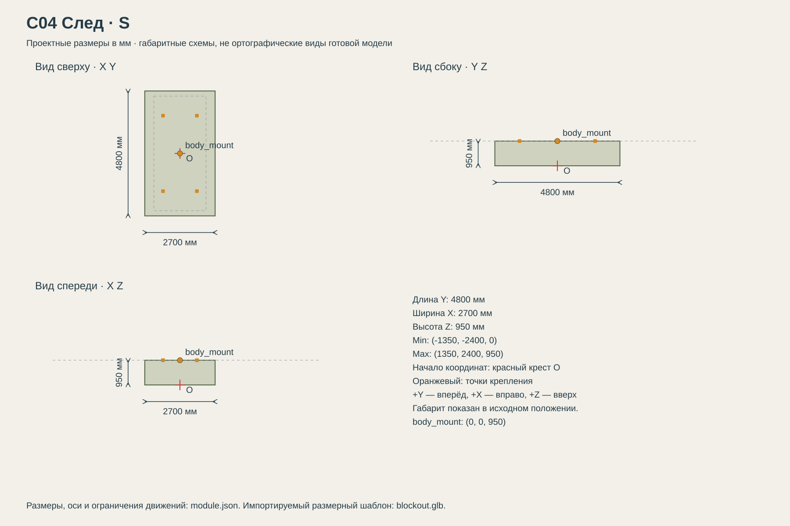

# C04 След

Лёгкие разведчики для мягкого грунта; медленнее колёсных на дороге.

## Размеры и крепления

**Размеры назначены для игры и обязательны для модели.** Концепт показывает внешний характер; численные размеры задаются здесь и в module.json, а не измеряются по пикселям.

| Параметр | Значение |
| --- | --- |
| Класс | S |
| Длина Y | 4800 мм |
| Ширина X | 2700 мм |
| Высота Z | 950 мм |
| Min X Y Z | (-1350, -2400, 0) мм |
| Max X Y Z | (1350, 2400, 950) мм |
| Оси | +X вправо, +Y вперёд, +Z вверх |
| Масштаб | 1000 мм = 1 м; GLB хранит метры |
| Начало координат | Центр машины на земле: Z=0 — опорная поверхность в исходной позе. |
| body_mount | (0, 0, 950) мм; центр контактной плоскости палубы |
| pad_FL | (-650, 1450, 950) мм; центр площадки 180 × 180 мм |
| pad_FR | (650, 1450, 950) мм; центр площадки 180 × 180 мм |
| pad_RL | (-650, -1450, 950) мм; центр площадки 180 × 180 мм |
| pad_RR | (650, -1450, 950) мм; центр площадки 180 × 180 мм |
| Рабочая область Min X Y Z | (-1350, -2400, 0) мм |
| Рабочая область Max X Y Z | (1350, 2400, 950) мм |
| Рабочая область | Консервативный объём для движений, не сплошной меш и не коллайдер |

[Открыть размерную заготовку GLB](blockout.glb). Это габаритный объём и пустые узлы креплений/движений; художественной геометрии и готовых анимаций в нём нет.

## Внешний вид

Две узкие гусеницы с небольшими катками и короткой базой.

## Подвижные части

Все центры ниже заданы в координатах всего модуля при исходной позе, в мм. Оси вращения заданы в локальной системе родителя. Положительное вращение — по правилу правой руки.

| Узел | Родитель | Центр X Y Z мм | Движение | Пределы или скорость |
| --- | --- | --- | --- | --- |
| sprocket_L | корень модуля | (-1050, -2100, 300) | rotation по X. Угол от пути своей стороны, радиус визуальной звёздочки 300 мм. | непрерывное вращение |
| track_L | корень модуля | (-1050, 0, 450) | uv_scroll по Y. Прокрутка UV вдоль замкнутой ленты. Не вращать всю гусеницу как цилиндр. | непрерывное вращение |
| sprocket_R | корень модуля | (1050, -2100, 300) | rotation по X. Угол от пути своей стороны, радиус визуальной звёздочки 300 мм. | непрерывное вращение |
| track_R | корень модуля | (1050, 0, 450) | uv_scroll по Y. Прокрутка UV вдоль замкнутой ленты. Не вращать всю гусеницу как цилиндр. | непрерывное вращение |

## Состояния и последовательность анимаций

- **Стоянка:** Смещение UV и вращение звёздочек не меняются.
- **Езда:** Для каждой стороны отдельно: UV = (UV - путь / 10500) mod 1. Звёздочки и катки согласованы с путём этой стороны.
- **Поворот:** Разная скорость левой и правой лент; при развороте на месте знаки скоростей противоположны. Ленты остаются на направляющих.

## Светящиеся элементы

Цвета указаны в sRGB HEX. Strength — условная безразмерная сила Emission для художественного материала. Это не освещённость в люменах. Отдельные источники света не добавлять, если они не перечислены.

Собственных светящихся элементов нет. Оранжевые метки крепления — краска, не подсветка.

## Зазоры и ограничения

- Центральная палуба: 4400 мм вдоль Y × 2000 мм вдоль X на Z=950 мм.
- Весь этот центральный прямоугольник выше монтажной плоскости свободен от собственной геометрии ходовой.
- Колёса, гусеницы и ноги не входят в объём установленного корпуса. Минимальный зазор до движущихся частей 150 мм.
- Оранжевые метки крепления — краска без Emission. Фары находятся на корпусе, не дублировать их на палубе.
- Катки не являются автомобильными шинами. Ширина ленты 550 мм; вся лента ниже палубы минимум на 100 мм.

## Файлы

- `reference.png` — отдельный фрагмент исходного концепта без перерисовки.
- `dimensions.svg` — три вида габаритного объёма в одном масштабе, с размерами и центрами креплений.
- `module.json` — источник размеров, узлов, состояний и подсветки.
- `blockout.glb` — размерный шаблон для импорта в 3D-редактор.

[Единый стандарт размеров](../../standards.md) · [Каталог](../../../README.md)
