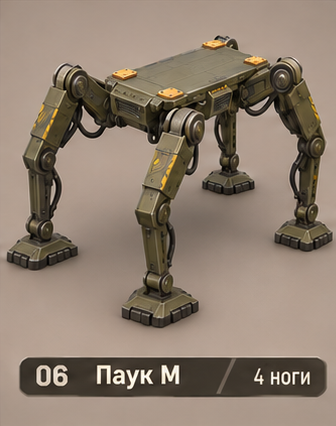
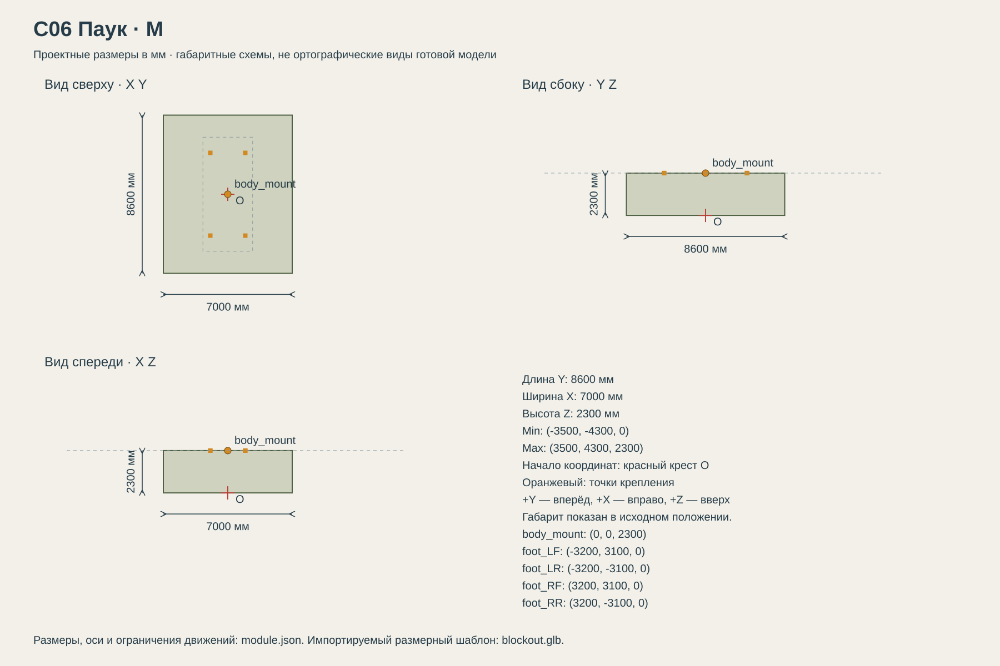

# C06 Паук

Пересечённая местность и преодоление небольших уступов; дорогая и высокая машина с заметными подвижными опорами. Не подразумевает ходьбу по стенам.

## Размеры и крепления

**Размеры назначены для игры и обязательны для модели.** Концепт показывает внешний характер; численные размеры задаются здесь и в module.json, а не измеряются по пикселям.

| Параметр | Значение |
| --- | --- |
| Класс | M |
| Длина Y | 8600 мм |
| Ширина X | 7000 мм |
| Высота Z | 2300 мм |
| Min X Y Z | (-3500, -4300, 0) мм |
| Max X Y Z | (3500, 4300, 2300) мм |
| Оси | +X вправо, +Y вперёд, +Z вверх |
| Масштаб | 1000 мм = 1 м; GLB хранит метры |
| Начало координат | Центр машины на земле: Z=0 — опорная поверхность в исходной позе. |
| body_mount | (0, 0, 2300) мм; центр контактной плоскости палубы |
| pad_FL | (-950, 2250, 2300) мм; центр площадки 240 × 240 мм |
| pad_FR | (950, 2250, 2300) мм; центр площадки 240 × 240 мм |
| pad_RL | (-950, -2250, 2300) мм; центр площадки 240 × 240 мм |
| pad_RR | (950, -2250, 2300) мм; центр площадки 240 × 240 мм |
| foot_LF | (-3200, 3100, 0) мм; контакт ступни с землёй, площадь 550 × 650 мм |
| foot_LR | (-3200, -3100, 0) мм; контакт ступни с землёй, площадь 550 × 650 мм |
| foot_RF | (3200, 3100, 0) мм; контакт ступни с землёй, площадь 550 × 650 мм |
| foot_RR | (3200, -3100, 0) мм; контакт ступни с землёй, площадь 550 × 650 мм |
| Рабочая область Min X Y Z | (-3500, -4300, 0) мм |
| Рабочая область Max X Y Z | (3500, 4300, 2300) мм |
| Рабочая область | Консервативный объём для движений, не сплошной меш и не коллайдер |

[Открыть размерную заготовку GLB](blockout.glb). Это габаритный объём и пустые узлы креплений/движений; художественной геометрии и готовых анимаций в нём нет.

## Внешний вид

Четыре длинные механические ноги с коленями и широкими ступнями.

## Подвижные части

Все центры ниже заданы в координатах всего модуля при исходной позе, в мм. Оси вращения заданы в локальной системе родителя. Положительное вращение — по правилу правой руки.

| Узел | Родитель | Центр X Y Z мм | Движение | Пределы или скорость |
| --- | --- | --- | --- | --- |
| hip_yaw_LF | корень модуля | (-1800, 2100, 1900) | rotation по Z.  | -35…35 градусов; исходное 0; 50 град/с |
| hip_pitch_LF | hip_yaw_LF | (-1800, 2100, 1900) | rotation по X.  | -40…50 градусов; исходное 0; 60 град/с |
| knee_LF | hip_pitch_LF | (-2700, 2700, 1200) | rotation по X.  | 0…100 градусов; исходное 0; 90 град/с |
| ankle_LF | knee_LF | (-3200, 3100, 150) | rotation по X.  | -25…25 градусов; исходное 0; 80 град/с |
| hip_yaw_LR | корень модуля | (-1800, -2100, 1900) | rotation по Z.  | -35…35 градусов; исходное 0; 50 град/с |
| hip_pitch_LR | hip_yaw_LR | (-1800, -2100, 1900) | rotation по X.  | -40…50 градусов; исходное 0; 60 град/с |
| knee_LR | hip_pitch_LR | (-2700, -2700, 1200) | rotation по X.  | 0…100 градусов; исходное 0; 90 град/с |
| ankle_LR | knee_LR | (-3200, -3100, 150) | rotation по X.  | -25…25 градусов; исходное 0; 80 град/с |
| hip_yaw_RF | корень модуля | (1800, 2100, 1900) | rotation по Z.  | -35…35 градусов; исходное 0; 50 град/с |
| hip_pitch_RF | hip_yaw_RF | (1800, 2100, 1900) | rotation по X.  | -40…50 градусов; исходное 0; 60 град/с |
| knee_RF | hip_pitch_RF | (2700, 2700, 1200) | rotation по X.  | 0…100 градусов; исходное 0; 90 град/с |
| ankle_RF | knee_RF | (3200, 3100, 150) | rotation по X.  | -25…25 градусов; исходное 0; 80 град/с |
| hip_yaw_RR | корень модуля | (1800, -2100, 1900) | rotation по Z.  | -35…35 градусов; исходное 0; 50 град/с |
| hip_pitch_RR | hip_yaw_RR | (1800, -2100, 1900) | rotation по X.  | -40…50 градусов; исходное 0; 60 град/с |
| knee_RR | hip_pitch_RR | (2700, -2700, 1200) | rotation по X.  | 0…100 градусов; исходное 0; 90 град/с |
| ankle_RR | knee_RR | (3200, -3100, 150) | rotation по X.  | -25…25 градусов; исходное 0; 80 град/с |

## Состояния и последовательность анимаций

- **Стоянка:** Четыре ступни на земле, body_mount Z=2300. Нельзя произвольно менять высоту сокета.
- **Ходьба:** Цикл 1.6 с. Диагональная пара LF+RR: фаза 0; RF+LR: фаза 0.5. Перенос ноги занимает первые 35% её цикла: подъём до 450 мм, ход вперёд 800 мм, опускание. Остальные 65% ступня опирается на землю. IK соблюдает пределы узлов.
- **Поворот:** Цели ступней описывают дугу вокруг корня машины; подъём тот же, перекрещивание траекторий запрещено.
- **Остановка:** Закончить перенос поднятой пары за оставшуюся часть цикла, поставить все ступни на поверхность.

## Светящиеся элементы

Цвета указаны в sRGB HEX. Strength — условная безразмерная сила Emission для художественного материала. Это не освещённость в люменах. Отдельные источники света не добавлять, если они не перечислены.

Собственных светящихся элементов нет. Оранжевые метки крепления — краска, не подсветка.

## Зазоры и ограничения

- Центральная палуба: 6200 мм вдоль Y × 2700 мм вдоль X на Z=2300 мм.
- Весь этот центральный прямоугольник выше монтажной плоскости свободен от собственной геометрии ходовой.
- Колёса, гусеницы и ноги не входят в объём установленного корпуса. Минимальный зазор до движущихся частей 150 мм.
- Оранжевые метки крепления — краска без Emission. Фары находятся на корпусе, не дублировать их на палубе.
- Габарит 8600 × 7000 × 2300 мм включает траектории ног, а не только корпус палубы.
- Палуба остаётся горизонтальной; стартовый набор не включает приседание или изменение высоты корпуса.

## Файлы

- `reference.png` — отдельный фрагмент исходного концепта без перерисовки.
- `dimensions.svg` — три вида габаритного объёма в одном масштабе, с размерами и центрами креплений.
- `module.json` — источник размеров, узлов, состояний и подсветки.
- `blockout.glb` — размерный шаблон для импорта в 3D-редактор.

[Единый стандарт размеров](../../standards.md) · [Каталог](../../../README.md)
