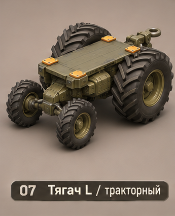
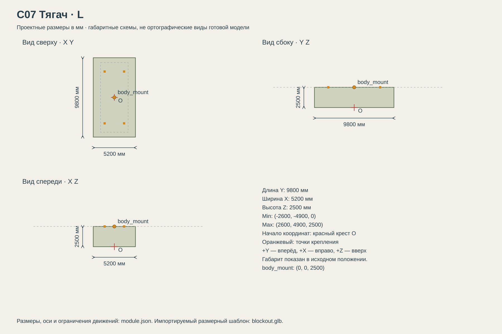

# C07 Тягач

Тяга, работа на мягком грунте и перемещение тяжёлого оборудования; медленная, с крупными открытыми колёсами. Отличается от C03 пропорциями, а не только числом осей.

## Размеры и крепления

**Размеры назначены для игры и обязательны для модели.** Концепт показывает внешний характер; численные размеры задаются здесь и в module.json, а не измеряются по пикселям.

| Параметр | Значение |
| --- | --- |
| Класс | L |
| Длина Y | 9800 мм |
| Ширина X | 5200 мм |
| Высота Z | 2500 мм |
| Min X Y Z | (-2600, -4900, 0) мм |
| Max X Y Z | (2600, 4900, 2500) мм |
| Оси | +X вправо, +Y вперёд, +Z вверх |
| Масштаб | 1000 мм = 1 м; GLB хранит метры |
| Начало координат | Центр машины на земле: Z=0 — опорная поверхность в исходной позе. |
| body_mount | (0, 0, 2500) мм; центр контактной плоскости палубы |
| pad_FL | (-1200, 3200, 2500) мм; центр площадки 300 × 300 мм |
| pad_FR | (1200, 3200, 2500) мм; центр площадки 300 × 300 мм |
| pad_RL | (-1200, -3200, 2500) мм; центр площадки 300 × 300 мм |
| pad_RR | (1200, -3200, 2500) мм; центр площадки 300 × 300 мм |
| Рабочая область Min X Y Z | (-2600, -4900, 0) мм |
| Рабочая область Max X Y Z | (2600, 4900, 2500) мм |
| Рабочая область | Консервативный объём для движений, не сплошной меш и не коллайдер |

[Открыть размерную заготовку GLB](blockout.glb). Это габаритный объём и пустые узлы креплений/движений; художественной геометрии и готовых анимаций в нём нет.

## Внешний вид

Тракторная база: два огромных задних колеса и два меньших передних, глубокий диагональный протектор.

## Подвижные части

Все центры ниже заданы в координатах всего модуля при исходной позе, в мм. Оси вращения заданы в локальной системе родителя. Положительное вращение — по правилу правой руки.

| Узел | Родитель | Центр X Y Z мм | Движение | Пределы или скорость |
| --- | --- | --- | --- | --- |
| axle_1_L_suspension | корень модуля | (-1800, 3000, 650) | translation по Z. Ход подвески относительно исходного центра. | -80…80 мм; исходное 0; 250 мм/с |
| axle_1_L_steer | axle_1_L_suspension | (-1800, 3000, 650) | rotation по Z. Только управляемая ось. | -32…32 градусов; исходное 0; 60 град/с |
| axle_1_L_wheel | axle_1_L_steer | (-1800, 3000, 650) | rotation по X. Угол = -пройденный путь / 650 радиан; одинаковая ось +X у левого и правого колеса. | непрерывное вращение |
| axle_1_R_suspension | корень модуля | (1800, 3000, 650) | translation по Z. Ход подвески относительно исходного центра. | -80…80 мм; исходное 0; 250 мм/с |
| axle_1_R_steer | axle_1_R_suspension | (1800, 3000, 650) | rotation по Z. Только управляемая ось. | -32…32 градусов; исходное 0; 60 град/с |
| axle_1_R_wheel | axle_1_R_steer | (1800, 3000, 650) | rotation по X. Угол = -пройденный путь / 650 радиан; одинаковая ось +X у левого и правого колеса. | непрерывное вращение |
| axle_2_L_suspension | корень модуля | (-2200, -2200, 1100) | translation по Z. Ход подвески относительно исходного центра. | -80…80 мм; исходное 0; 250 мм/с |
| axle_2_L_wheel | axle_2_L_suspension | (-2200, -2200, 1100) | rotation по X. Угол = -пройденный путь / 1100 радиан; одинаковая ось +X у левого и правого колеса. | непрерывное вращение |
| axle_2_R_suspension | корень модуля | (2200, -2200, 1100) | translation по Z. Ход подвески относительно исходного центра. | -80…80 мм; исходное 0; 250 мм/с |
| axle_2_R_wheel | axle_2_R_suspension | (2200, -2200, 1100) | rotation по X. Угол = -пройденный путь / 1100 радиан; одинаковая ось +X у левого и правого колеса. | непрерывное вращение |

## Состояния и последовательность анимаций

- **Стоянка:** Рулевые узлы 0, ход подвески 0. Вращение колёс остановлено.
- **Езда:** Вращение колёс определяется фактическим пройденным путём, не произвольной частотой. Подвеска следует грунту в своих пределах.
- **Поворот:** Управляемые колёса поворачиваются вокруг Z, остальные остаются по направлению корпуса. У второй управляемой оси угол 70% первой. Для внутреннего и внешнего колеса применяется разница углов без выхода за пределы.
- **Торможение:** Частота вращения уменьшается вместе со скоростью движения; не останавливать колёса до остановки машины.

## Светящиеся элементы

Цвета указаны в sRGB HEX. Strength — условная безразмерная сила Emission для художественного материала. Это не освещённость в люменах. Отдельные источники света не добавлять, если они не перечислены.

Собственных светящихся элементов нет. Оранжевые метки крепления — краска, не подсветка.

## Зазоры и ограничения

- Центральная палуба: 8600 мм вдоль Y × 3400 мм вдоль X на Z=2500 мм.
- Весь этот центральный прямоугольник выше монтажной плоскости свободен от собственной геометрии ходовой.
- Колёса, гусеницы и ноги не входят в объём установленного корпуса. Минимальный зазор до движущихся частей 150 мм.
- Оранжевые метки крепления — краска без Emission. Фары находятся на корпусе, не дублировать их на палубе.
- Передние колёса: диаметр 1300 мм, задние 2200 мм. Ширина шин 700 мм. Палуба Z=2500 выше верхней точки задних шин Z=2200 на 300 мм.

## Файлы

- `reference.png` — отдельный фрагмент исходного концепта без перерисовки.
- `dimensions.svg` — три вида габаритного объёма в одном масштабе, с размерами и центрами креплений.
- `module.json` — источник размеров, узлов, состояний и подсветки.
- `blockout.glb` — размерный шаблон для импорта в 3D-редактор.

[Единый стандарт размеров](../../standards.md) · [Каталог](../../../README.md)
