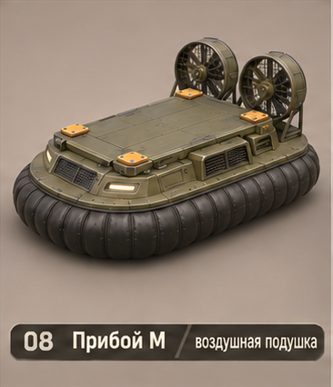
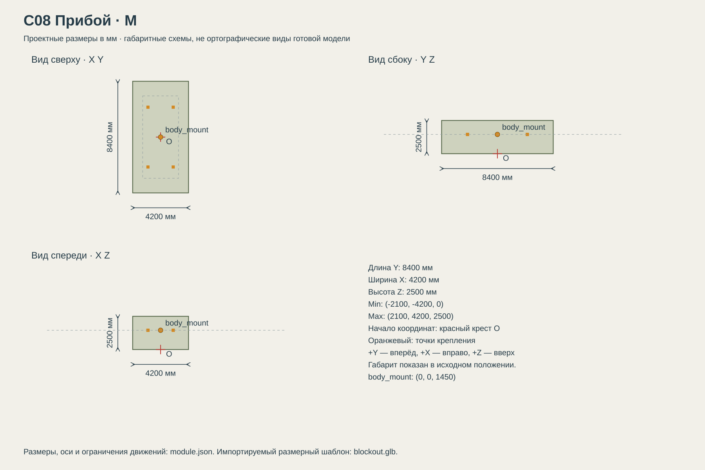

# C08 Прибой

Вода, болота и ровные открытые участки; не перелетает препятствия и плохо подходит для крутых уступов.

## Размеры и крепления

**Размеры назначены для игры и обязательны для модели.** Концепт показывает внешний характер; численные размеры задаются здесь и в module.json, а не измеряются по пикселям.

| Параметр | Значение |
| --- | --- |
| Класс | M |
| Длина Y | 8400 мм |
| Ширина X | 4200 мм |
| Высота Z | 2500 мм |
| Min X Y Z | (-2100, -4200, 0) мм |
| Max X Y Z | (2100, 4200, 2500) мм |
| Оси | +X вправо, +Y вперёд, +Z вверх |
| Масштаб | 1000 мм = 1 м; GLB хранит метры |
| Начало координат | Центр машины на земле: Z=0 — опорная поверхность в исходной позе. |
| body_mount | (0, 0, 1450) мм; центр контактной плоскости палубы |
| pad_FL | (-950, 2250, 1450) мм; центр площадки 240 × 240 мм |
| pad_FR | (950, 2250, 1450) мм; центр площадки 240 × 240 мм |
| pad_RL | (-950, -2250, 1450) мм; центр площадки 240 × 240 мм |
| pad_RR | (950, -2250, 1450) мм; центр площадки 240 × 240 мм |
| Рабочая область Min X Y Z | (-2100, -4200, 0) мм |
| Рабочая область Max X Y Z | (2100, 4200, 2500) мм |
| Рабочая область | Консервативный объём для движений, не сплошной меш и не коллайдер |

[Открыть размерную заготовку GLB](blockout.glb). Это габаритный объём и пустые узлы креплений/движений; художественной геометрии и готовых анимаций в нём нет.

## Внешний вид

Воздушная подушка: округлая платформа на чёрной гибкой юбке, два кормовых толкающих вентилятора.

## Подвижные части

Все центры ниже заданы в координатах всего модуля при исходной позе, в мм. Оси вращения заданы в локальной системе родителя. Положительное вращение — по правилу правой руки.

| Узел | Родитель | Центр X Y Z мм | Движение | Пределы или скорость |
| --- | --- | --- | --- | --- |
| skirt | корень модуля | (0, 0, 400) | Изменение scaleZ только у юбки, вокруг её локального центра. | 0.85…1.05; исходный scaleZ=1; X/Y всегда 1 |
| fan_L | корень модуля | (-1500, -3900, 1900) | rotation по Y. Вентилятор в плоскости XZ; запускается за 0.8 с. | непрерывное вращение; 1800 град/с |
| rudder_L | корень модуля | (-1500, -4050, 1900) | rotation по Z. Рулевой щиток позади вентилятора. | -25…25 градусов; исходное 0; 60 град/с |
| fan_R | корень модуля | (1500, -3900, 1900) | rotation по Y. Вентилятор в плоскости XZ; запускается за 0.8 с. | непрерывное вращение; 1800 град/с |
| rudder_R | корень модуля | (1500, -4050, 1900) | rotation по Z. Рулевой щиток позади вентилятора. | -25…25 градусов; исходное 0; 60 град/с |

## Состояния и последовательность анимаций

- **Стоянка:** Вентиляторы выключены, юбка scaleZ=0.85, руль 0.
- **Запуск:** За 0.8 с вентиляторы набирают 1800 град/с; юбка scaleZ=1.
- **Ход:** Руль ±25; при движении юбка колеблется в пределах 0.97…1.03 с периодом 1.2 с. Центральную палубу не масштабировать.
- **Остановка:** Плавно остановить вентиляторы за 1.2 с, затем юбка 0.85.

## Светящиеся элементы

Цвета указаны в sRGB HEX. Strength — условная безразмерная сила Emission для художественного материала. Это не освещённость в люменах. Отдельные источники света не добавлять, если они не перечислены.

Собственных светящихся элементов нет. Оранжевые метки крепления — краска, не подсветка.

## Зазоры и ограничения

- Центральная палуба: 6200 мм вдоль Y × 2700 мм вдоль X на Z=1450 мм.
- Весь этот центральный прямоугольник выше монтажной плоскости свободен от собственной геометрии ходовой.
- Колёса, гусеницы и ноги не входят в объём установленного корпуса. Минимальный зазор до движущихся частей 150 мм.
- Оранжевые метки крепления — краска без Emission. Фары находятся на корпусе, не дублировать их на палубе.
- Два кормовых вентилятора: радиус 550 мм, центры Y=-3900. Они за пределами центральной палубы (задняя граница Y=-3100); корпус не должен иметь задних выступов за заданный габарит.

## Файлы

- `reference.png` — отдельный фрагмент исходного концепта без перерисовки.
- `dimensions.svg` — три вида габаритного объёма в одном масштабе, с размерами и центрами креплений.
- `module.json` — источник размеров, узлов, состояний и подсветки.
- `blockout.glb` — размерный шаблон для импорта в 3D-редактор.

[Единый стандарт размеров](../../standards.md) · [Каталог](../../../README.md)
