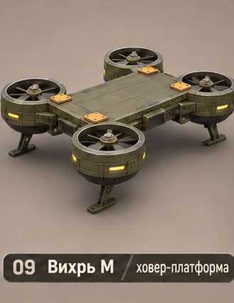
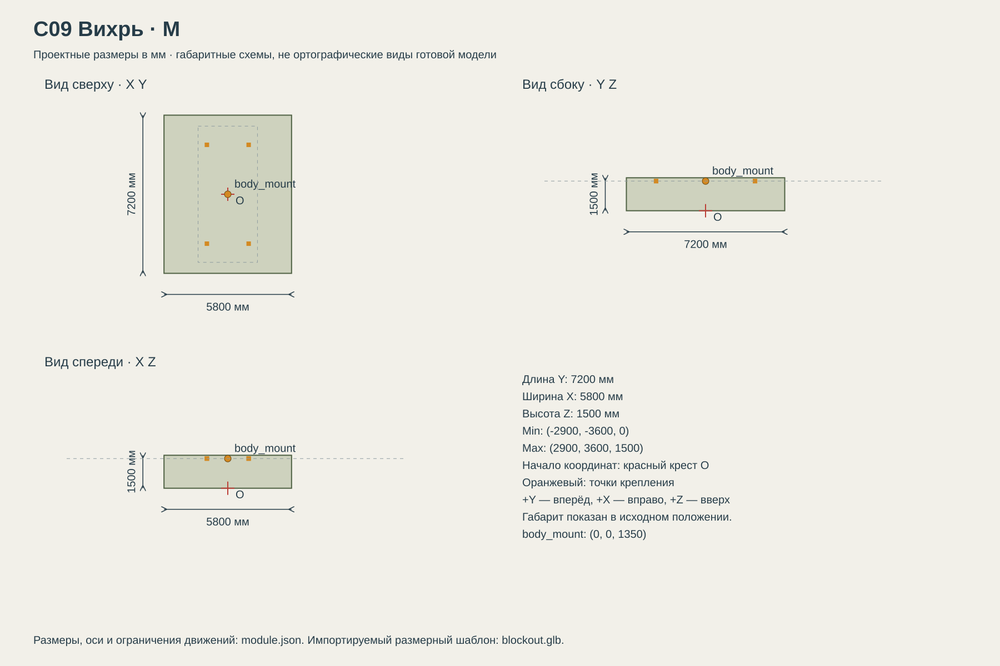

# C09 Вихрь

Движение над поверхностью и небольшими препятствиями; высокая энергозависимость и чувствительность к перегрузке. Полноценный полёт не предусмотрен базовой концепцией.

## Размеры и крепления

**Размеры назначены для игры и обязательны для модели.** Концепт показывает внешний характер; численные размеры задаются здесь и в module.json, а не измеряются по пикселям.

| Параметр | Значение |
| --- | --- |
| Класс | M |
| Длина Y | 7200 мм |
| Ширина X | 5800 мм |
| Высота Z | 1500 мм |
| Min X Y Z | (-2900, -3600, 0) мм |
| Max X Y Z | (2900, 3600, 1500) мм |
| Оси | +X вправо, +Y вперёд, +Z вверх |
| Масштаб | 1000 мм = 1 м; GLB хранит метры |
| Начало координат | Центр машины на земле: Z=0 — опорная поверхность в исходной позе. |
| body_mount | (0, 0, 1350) мм; центр контактной плоскости палубы |
| pad_FL | (-950, 2250, 1350) мм; центр площадки 240 × 240 мм |
| pad_FR | (950, 2250, 1350) мм; центр площадки 240 × 240 мм |
| pad_RL | (-950, -2250, 1350) мм; центр площадки 240 × 240 мм |
| pad_RR | (950, -2250, 1350) мм; центр площадки 240 × 240 мм |
| Рабочая область Min X Y Z | (-2900, -3600, 0) мм |
| Рабочая область Max X Y Z | (2900, 3600, 1500) мм |
| Рабочая область | Консервативный объём для движений, не сплошной меш и не коллайдер |

[Открыть размерную заготовку GLB](blockout.glb). Это габаритный объём и пустые узлы креплений/движений; художественной геометрии и готовых анимаций в нём нет.

## Внешний вид

Фантастическая ховер-платформа: четыре вертикальных подъёмных вентилятора по углам и посадочные опоры.

## Подвижные части

Все центры ниже заданы в координатах всего модуля при исходной позе, в мм. Оси вращения заданы в локальной системе родителя. Положительное вращение — по правилу правой руки.

| Узел | Родитель | Центр X Y Z мм | Движение | Пределы или скорость |
| --- | --- | --- | --- | --- |
| lift_rotor_1 | корень модуля | (-2250, 2500, 700) | rotation по Z. Радиус лопастей 500 мм; внутренний диаметр кожуха 1100 мм. | непрерывное вращение; 1800 град/с |
| lift_rotor_2 | корень модуля | (2250, 2500, 700) | rotation по Z. Радиус лопастей 500 мм; внутренний диаметр кожуха 1100 мм. | непрерывное вращение; -1800 град/с |
| lift_rotor_3 | корень модуля | (-2250, -2500, 700) | rotation по Z. Радиус лопастей 500 мм; внутренний диаметр кожуха 1100 мм. | непрерывное вращение; -1800 град/с |
| lift_rotor_4 | корень модуля | (2250, -2500, 700) | rotation по Z. Радиус лопастей 500 мм; внутренний диаметр кожуха 1100 мм. | непрерывное вращение; 1800 град/с |
| landing_leg_1 | корень модуля | (-2250, 2500, 300) | translation по Z. Телескопическая опора, убирается вверх. | 0…250 мм; исходное 0; 250 мм/с |
| landing_leg_2 | корень модуля | (2250, 2500, 300) | translation по Z. Телескопическая опора, убирается вверх. | 0…250 мм; исходное 0; 250 мм/с |
| landing_leg_3 | корень модуля | (-2250, -2500, 300) | translation по Z. Телескопическая опора, убирается вверх. | 0…250 мм; исходное 0; 250 мм/с |
| landing_leg_4 | корень модуля | (2250, -2500, 300) | translation по Z. Телескопическая опора, убирается вверх. | 0…250 мм; исходное 0; 250 мм/с |

## Состояния и последовательность анимаций

- **Посадка:** Опоры выдвинуты: ход 0; низ опор Z=0. Роторы остановлены.
- **Подъём:** Роторы набирают рабочую скорость за 1 с. Вся машина поднимается на 500 мм; затем опоры убираются на 250 мм за 1 с.
- **Парение:** Корень всей машины находится на 500 мм над поверхностью. Допустимое плавное покачивание всего объекта по Z ±50 мм с периодом 2 с; это не смещение body_mount внутри ходовой.
- **Остановка:** Выдвинуть опоры в 0, опустить всю машину на грунт, остановить роторы за 1 с.

## Светящиеся элементы

Цвета указаны в sRGB HEX. Strength — условная безразмерная сила Emission для художественного материала. Это не освещённость в люменах. Отдельные источники света не добавлять, если они не перечислены.

Собственных светящихся элементов нет. Оранжевые метки крепления — краска, не подсветка.

## Зазоры и ограничения

- Центральная палуба: 6200 мм вдоль Y × 2700 мм вдоль X на Z=1350 мм.
- Весь этот центральный прямоугольник выше монтажной плоскости свободен от собственной геометрии ходовой.
- Колёса, гусеницы и ноги не входят в объём установленного корпуса. Минимальный зазор до движущихся частей 150 мм.
- Оранжевые метки крепления — краска без Emission. Фары находятся на корпусе, не дублировать их на палубе.
- Для каждого вентилятора свободен вертикальный канал радиусом 600 мм от Z=700 вверх. Корпус укладывается в X=±1350; внутренний край каналов X=±1650, запас 300 мм. Декоративные крылья корпуса запрещены.

## Файлы

- `reference.png` — отдельный фрагмент исходного концепта без перерисовки.
- `dimensions.svg` — три вида габаритного объёма в одном масштабе, с размерами и центрами креплений.
- `module.json` — источник размеров, узлов, состояний и подсветки.
- `blockout.glb` — размерный шаблон для импорта в 3D-редактор.

[Единый стандарт размеров](../../standards.md) · [Каталог](../../../README.md)
