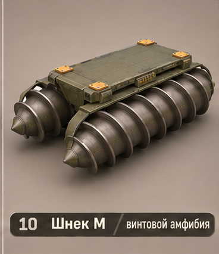
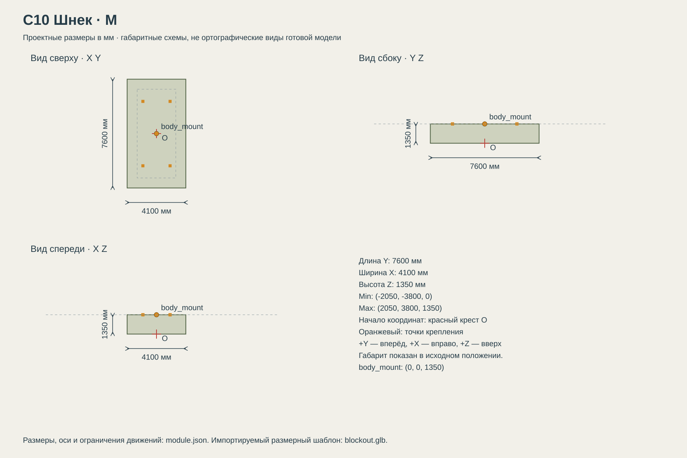

# C10 Шнек

Специалист по болотам, снегу и воде; очень слабая эффективность на твёрдых покрытиях.

## Размеры и крепления

**Размеры назначены для игры и обязательны для модели.** Концепт показывает внешний характер; численные размеры задаются здесь и в module.json, а не измеряются по пикселям.

| Параметр | Значение |
| --- | --- |
| Класс | M |
| Длина Y | 7600 мм |
| Ширина X | 4100 мм |
| Высота Z | 1350 мм |
| Min X Y Z | (-2050, -3800, 0) мм |
| Max X Y Z | (2050, 3800, 1350) мм |
| Оси | +X вправо, +Y вперёд, +Z вверх |
| Масштаб | 1000 мм = 1 м; GLB хранит метры |
| Начало координат | Центр машины на земле: Z=0 — опорная поверхность в исходной позе. |
| body_mount | (0, 0, 1350) мм; центр контактной плоскости палубы |
| pad_FL | (-950, 2250, 1350) мм; центр площадки 240 × 240 мм |
| pad_FR | (950, 2250, 1350) мм; центр площадки 240 × 240 мм |
| pad_RL | (-950, -2250, 1350) мм; центр площадки 240 × 240 мм |
| pad_RR | (950, -2250, 1350) мм; центр площадки 240 × 240 мм |
| Рабочая область Min X Y Z | (-2050, -3800, 0) мм |
| Рабочая область Max X Y Z | (2050, 3800, 1350) мм |
| Рабочая область | Консервативный объём для движений, не сплошной меш и не коллайдер |

[Открыть размерную заготовку GLB](blockout.glb). Это габаритный объём и пустые узлы креплений/движений; художественной геометрии и готовых анимаций в нём нет.

## Внешний вид

Два продольных цилиндрических поплавка со спиральными рёбрами вместо колёс.

## Подвижные части

Все центры ниже заданы в координатах всего модуля при исходной позе, в мм. Оси вращения заданы в локальной системе родителя. Положительное вращение — по правилу правой руки.

| Узел | Родитель | Центр X Y Z мм | Движение | Пределы или скорость |
| --- | --- | --- | --- | --- |
| screw_L | корень модуля | (-1450, 0, 550) | rotation по Y. Два противоположных направления навивки; угол = +360 × путь / 900 градусов. | непрерывное вращение |
| screw_R | корень модуля | (1450, 0, 550) | rotation по Y. Два противоположных направления навивки; угол = -360 × путь / 900 градусов. | непрерывное вращение |

## Состояния и последовательность анимаций

- **Стоянка:** Шнеки неподвижны.
- **Ход:** Оба шнека вращаются в противоположных направлениях согласно формуле. Путь в мм, один условный оборот соответствует 900 мм игрового перемещения.
- **Поворот:** Скорости шнеков отличаются по команде поворота; не вращать всю платформу вместе с цилиндрами.
- **На воде:** Корень следует уровню воды; допускается качка всего объекта ±3° вокруг X/Y, период 3 с. Сокет остаётся жёстко связан с палубой.

## Светящиеся элементы

Цвета указаны в sRGB HEX. Strength — условная безразмерная сила Emission для художественного материала. Это не освещённость в люменах. Отдельные источники света не добавлять, если они не перечислены.

Собственных светящихся элементов нет. Оранжевые метки крепления — краска, не подсветка.

## Зазоры и ограничения

- Центральная палуба: 6200 мм вдоль Y × 2700 мм вдоль X на Z=1350 мм.
- Весь этот центральный прямоугольник выше монтажной плоскости свободен от собственной геометрии ходовой.
- Колёса, гусеницы и ноги не входят в объём установленного корпуса. Минимальный зазор до движущихся частей 150 мм.
- Оранжевые метки крепления — краска без Emission. Фары находятся на корпусе, не дублировать их на палубе.
- Диаметр каждого шнека 1000 мм, длина 7200 мм, шаг художественной спирали 900 мм, высота ребра включена в диаметр. Левая и правая спирали зеркальны; отдельные кольца недопустимы.

## Файлы

- `reference.png` — отдельный фрагмент исходного концепта без перерисовки.
- `dimensions.svg` — три вида габаритного объёма в одном масштабе, с размерами и центрами креплений.
- `module.json` — источник размеров, узлов, состояний и подсветки.
- `blockout.glb` — размерный шаблон для импорта в 3D-редактор.

[Единый стандарт размеров](../../standards.md) · [Каталог](../../../README.md)
