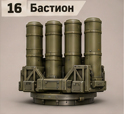
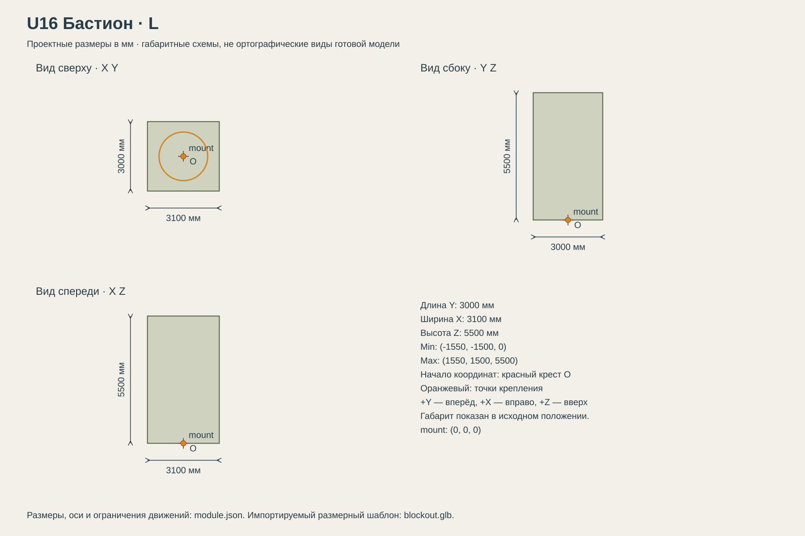

# U16 Бастион

Дальняя зональная ПВО; дорогая машина прикрытия группы.

## Размеры и крепления

**Размеры назначены для игры и обязательны для модели.** Концепт показывает внешний характер; численные размеры задаются здесь и в module.json, а не измеряются по пикселям.

| Параметр | Значение |
| --- | --- |
| Класс | L |
| Длина Y | 3000 мм |
| Ширина X | 3100 мм |
| Высота Z | 5500 мм |
| Min X Y Z | (-1550, -1500, 0) мм |
| Max X Y Z | (1550, 1500, 5500) мм |
| Оси | +X вправо, +Y вперёд, +Z вверх |
| Масштаб | 1000 мм = 1 м; GLB хранит метры |
| Начало координат | Центр нижней плоскости фланца; совпадает с upper_mount корпуса. |
| mount | (0, 0, 0) мм; нижняя плоскость фланца; yaw = 0 смотрит вдоль +Y |
| Рабочая область Min X Y Z | (-2200, -2200, 0) мм |
| Рабочая область Max X Y Z | (2200, 2200, 6200) мм |
| Рабочая область | Консервативный объём для движений, не сплошной меш и не коллайдер |
| Диаметр верхнего интерфейса | 2100 мм |
| Высота фланца верхнего модуля | 120 мм над его нулевой плоскостью |

[Открыть размерную заготовку GLB](blockout.glb). Это габаритный объём и пустые узлы креплений/движений; художественной геометрии и готовых анимаций в нём нет.

## Внешний вид

Четыре высоких вертикальных цилиндрических контейнера.

## Подвижные части

Все центры ниже заданы в координатах всего модуля при исходной позе, в мм. Оси вращения заданы в локальной системе родителя. Положительное вращение — по правилу правой руки.

| Узел | Родитель | Центр X Y Z мм | Движение | Пределы или скорость |
| --- | --- | --- | --- | --- |
| cap_1 | корень модуля | (-700, -380, 5420) | rotation по X. Крышка отдельного вертикального контейнера, открывается наружу. | 0…110 градусов; исходное 0; 110 град/с |
| cap_2 | корень модуля | (700, -380, 5420) | rotation по X. Крышка отдельного вертикального контейнера, открывается наружу. | 0…110 градусов; исходное 0; 110 град/с |
| cap_3 | корень модуля | (-700, 1020, 5420) | rotation по X. Крышка отдельного вертикального контейнера, открывается наружу. | 0…110 градусов; исходное 0; 110 град/с |
| cap_4 | корень модуля | (700, 1020, 5420) | rotation по X. Крышка отдельного вертикального контейнера, открывается наружу. | 0…110 градусов; исходное 0; 110 град/с |

## Состояния и последовательность анимаций

- **Транспорт:** Все четыре крышки закрыты, угол 0. Блок контейнеров неподвижен.
- **Работа:** Крышка выбранной ячейки открывается до 110 за 1 с, после события закрывается за 1 с. Другие крышки не двигаются.

## Светящиеся элементы

Цвета указаны в sRGB HEX. Strength — условная безразмерная сила Emission для художественного материала. Это не освещённость в люменах. Отдельные источники света не добавлять, если они не перечислены.

| Материал или узел | Центр X Y Z мм | Цвет | Strength | Когда работает |
| --- | --- | --- | --- | --- |
| status | (0, -1440, 180) | #75D58A | 1 | Дежурный режим: 0.25; работа: 1; неисправность: #FF6238, 1 Гц. Здоровый модуль не мигает. |

## Зазоры и ограничения

- Вся жёсткая геометрия в исходной позе находится внутри заданного габарита; кроме эффектов части не уходят ниже Z=0.
- Фланец: диаметр 2100 мм, высота 120 мм. Нижняя плоскость Z=0.
- Минимальный зазор движущихся твёрдых частей друг от друга — 30 мм. Рисунок не задаёт численную геометрию скрытой стороны.

## Файлы

- `reference.png` — отдельный фрагмент исходного концепта без перерисовки.
- `dimensions.svg` — три вида габаритного объёма в одном масштабе, с размерами и центрами креплений.
- `module.json` — источник размеров, узлов, состояний и подсветки.
- `blockout.glb` — размерный шаблон для импорта в 3D-редактор.

[Единый стандарт размеров](../../standards.md) · [Каталог](../../../README.md)
