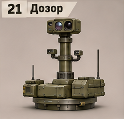
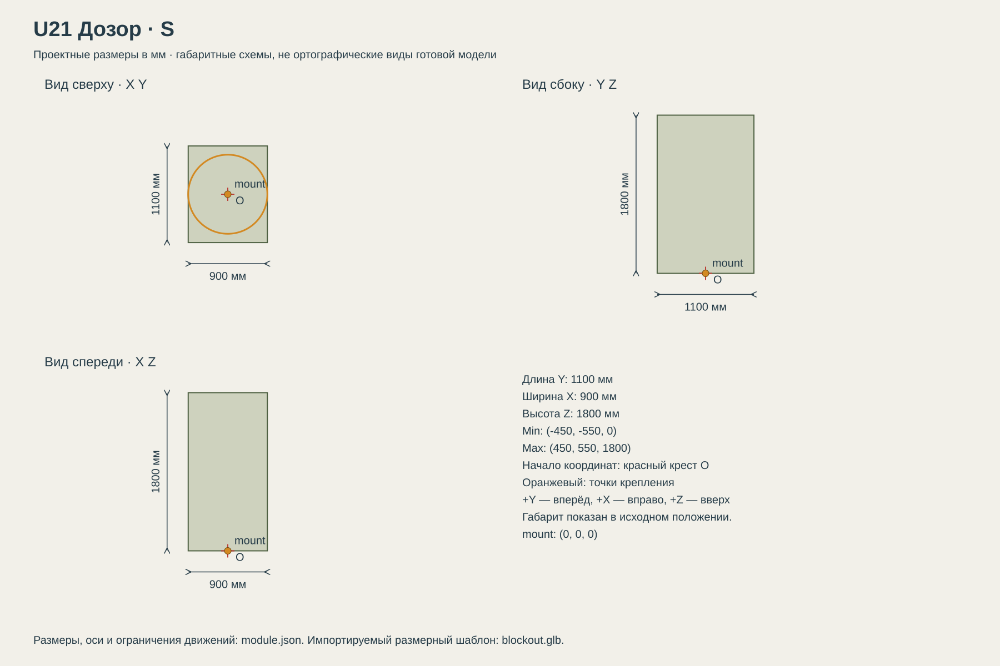

# U21 Дозор

Разведка и обнаружение; сам по себе не является оружием.

## Размеры и крепления

**Размеры назначены для игры и обязательны для модели.** Концепт показывает внешний характер; численные размеры задаются здесь и в module.json, а не измеряются по пикселям.

| Параметр | Значение |
| --- | --- |
| Класс | S |
| Длина Y | 1100 мм |
| Ширина X | 900 мм |
| Высота Z | 1800 мм |
| Min X Y Z | (-450, -550, 0) мм |
| Max X Y Z | (450, 550, 1800) мм |
| Оси | +X вправо, +Y вперёд, +Z вверх |
| Масштаб | 1000 мм = 1 м; GLB хранит метры |
| Начало координат | Центр нижней плоскости фланца; совпадает с upper_mount корпуса. |
| mount | (0, 0, 0) мм; нижняя плоскость фланца; yaw = 0 смотрит вдоль +Y |
| Рабочая область Min X Y Z | (-450, -550, 0) мм |
| Рабочая область Max X Y Z | (450, 550, 3500) мм |
| Рабочая область | Консервативный объём для движений, не сплошной меш и не коллайдер |
| Диаметр верхнего интерфейса | 900 мм |
| Высота фланца верхнего модуля | 80 мм над его нулевой плоскостью |

[Открыть размерную заготовку GLB](blockout.glb). Это габаритный объём и пустые узлы креплений/движений; художественной геометрии и готовых анимаций в нём нет.

## Внешний вид

Одна тонкая телескопическая мачта с камерой и небольшой оптической головкой.

## Подвижные части

Все центры ниже заданы в координатах всего модуля при исходной позе, в мм. Оси вращения заданы в локальной системе родителя. Положительное вращение — по правилу правой руки.

| Узел | Родитель | Центр X Y Z мм | Движение | Пределы или скорость |
| --- | --- | --- | --- | --- |
| mast_extend | корень модуля | (0, 0, 700) | translation по Z. Выдвигается верхняя секция, 2 с. | 0…1700 мм; исходное 0; 850 мм/с |
| camera_yaw | mast_extend | (0, 0, 1550) | rotation по Z.  | непрерывное вращение; 60 град/с |
| camera_pitch | camera_yaw | (0, 100, 1550) | rotation по X.  | -60…80 градусов; исходное 0; 45 град/с |

## Состояния и последовательность анимаций

- **Транспорт:** Мачта 0, камера yaw=0/pitch=0.
- **Обзор:** Мачта +1700 мм; затем камера вращается независимо, до 60 град/с.
- **Складывание:** Сначала камера возвращается в 0 за 0.5 с, затем мачта опускается за 2 с.

## Светящиеся элементы

Цвета указаны в sRGB HEX. Strength — условная безразмерная сила Emission для художественного материала. Это не освещённость в люменах. Отдельные источники света не добавлять, если они не перечислены.

| Материал или узел | Центр X Y Z мм | Цвет | Strength | Когда работает |
| --- | --- | --- | --- | --- |
| status | (0, -490, 180) | #75D58A | 1 | Дежурный режим: 0.25; работа: 1; неисправность: #FF6238, 1 Гц. Здоровый модуль не мигает. |

## Зазоры и ограничения

- Вся жёсткая геометрия в исходной позе находится внутри заданного габарита; кроме эффектов части не уходят ниже Z=0.
- Фланец: диаметр 900 мм, высота 80 мм. Нижняя плоскость Z=0.
- Минимальный зазор движущихся твёрдых частей друг от друга — 30 мм. Рисунок не задаёт численную геометрию скрытой стороны.

## Файлы

- `reference.png` — отдельный фрагмент исходного концепта без перерисовки.
- `dimensions.svg` — три вида габаритного объёма в одном масштабе, с размерами и центрами креплений.
- `module.json` — источник размеров, узлов, состояний и подсветки.
- `blockout.glb` — размерный шаблон для импорта в 3D-редактор.

[Единый стандарт размеров](../../standards.md) · [Каталог](../../../README.md)
