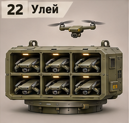
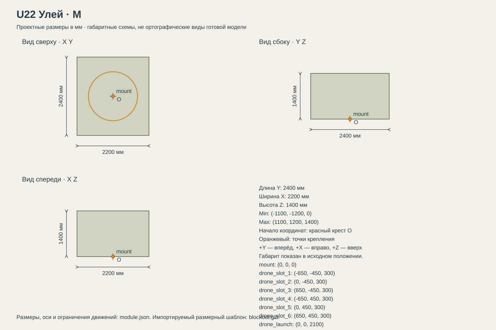

# U22 Улей

Носитель воздушных дронов; разведка или другие функции зависят от выбранного типа дронов.

## Размеры и крепления

**Размеры назначены для игры и обязательны для модели.** Концепт показывает внешний характер; численные размеры задаются здесь и в module.json, а не измеряются по пикселям.

| Параметр | Значение |
| --- | --- |
| Класс | M |
| Длина Y | 2400 мм |
| Ширина X | 2200 мм |
| Высота Z | 1400 мм |
| Min X Y Z | (-1100, -1200, 0) мм |
| Max X Y Z | (1100, 1200, 1400) мм |
| Оси | +X вправо, +Y вперёд, +Z вверх |
| Масштаб | 1000 мм = 1 м; GLB хранит метры |
| Начало координат | Центр нижней плоскости фланца; совпадает с upper_mount корпуса. |
| mount | (0, 0, 0) мм; нижняя плоскость фланца; yaw = 0 смотрит вдоль +Y |
| drone_slot_1 | (-650, -450, 300) мм; хранение сложенного D01 |
| drone_slot_2 | (0, -450, 300) мм; хранение сложенного D01 |
| drone_slot_3 | (650, -450, 300) мм; хранение сложенного D01 |
| drone_slot_4 | (-650, 450, 300) мм; хранение сложенного D01 |
| drone_slot_5 | (0, 450, 300) мм; хранение сложенного D01 |
| drone_slot_6 | (650, 450, 300) мм; хранение сложенного D01 |
| drone_launch | (0, 0, 2100) мм; точка выхода: дрон уже отделён от носителя |
| Рабочая область Min X Y Z | (-1300, -1600, 0) мм |
| Рабочая область Max X Y Z | (1300, 1400, 3300) мм |
| Рабочая область | Консервативный объём для движений, не сплошной меш и не коллайдер |
| Диаметр верхнего интерфейса | 1500 мм |
| Высота фланца верхнего модуля | 100 мм над его нулевой плоскостью |

[Открыть размерную заготовку GLB](blockout.glb). Это габаритный объём и пустые узлы креплений/движений; художественной геометрии и готовых анимаций в нём нет.

## Внешний вид

Прямоугольный шкаф с отдельными ячейками сложенных квадрокоптеров; дрон над ним показан для масштаба.

## Подвижные части

Все центры ниже заданы в координатах всего модуля при исходной позе, в мм. Оси вращения заданы в локальной системе родителя. Положительное вращение — по правилу правой руки.

| Узел | Родитель | Центр X Y Z мм | Движение | Пределы или скорость |
| --- | --- | --- | --- | --- |
| hatch | корень модуля | (0, -950, 1250) | rotation по X. Общая крышка; не пересекать стартовые траектории. | 0…105 градусов; исходное 0; 70 град/с |

## Состояния и последовательность анимаций

- **Транспорт:** Крышка 0, шесть дронов в слотах, моторы выключены, лучи сложены.
- **Запуск:** Открыть крышку 0→105° за 1.5 с. Поднять выбранный сложенный дрон в drone_launch за 1 с. Выполнить состояние «Раскрытие» из D01 целиком; после него разрешить роторы и выход. Следующий дрон ждёт освобождения точки.
- **Возврат:** Захватить дрон в drone_launch, выполнить состояние «Возврат» D01. Опустить полностью сложенный дрон в свободный слот за 1 с. После последнего дрона закрыть крышку за 1.5 с.

## Светящиеся элементы

Цвета указаны в sRGB HEX. Strength — условная безразмерная сила Emission для художественного материала. Это не освещённость в люменах. Отдельные источники света не добавлять, если они не перечислены.

| Материал или узел | Центр X Y Z мм | Цвет | Strength | Когда работает |
| --- | --- | --- | --- | --- |
| status | (0, -1140, 180) | #75D58A | 1 | Дежурный режим: 0.25; работа: 1; неисправность: #FF6238, 1 Гц. Здоровый модуль не мигает. |

## Зазоры и ограничения

- Вся жёсткая геометрия в исходной позе находится внутри заданного габарита; кроме эффектов части не уходят ниже Z=0.
- Фланец: диаметр 1500 мм, высота 100 мм. Нижняя плоскость Z=0.
- Минимальный зазор движущихся твёрдых частей друг от друга — 30 мм. Рисунок не задаёт численную геометрию скрытой стороны.
- Все игровые дроны — отдельные D01. Не объединять их с мешем U22. Запуск только при остановившейся машине; точка подъёма должна быть свободна.

## Отдельные объекты

- [D01](../../payloads/D01-scout-quadcopter/README.md): 6 экземпляров; Разведывательный квадрокоптер; хранится сложенным, запускается по одному.
  - drone_slot_1: (-650, -450, 300) мм.
  - drone_slot_2: (0, -450, 300) мм.
  - drone_slot_3: (650, -450, 300) мм.
  - drone_slot_4: (-650, 450, 300) мм.
  - drone_slot_5: (0, 450, 300) мм.
  - drone_slot_6: (650, 450, 300) мм.

## Файлы

- `reference.png` — отдельный фрагмент исходного концепта без перерисовки.
- `dimensions.svg` — три вида габаритного объёма в одном масштабе, с размерами и центрами креплений.
- `module.json` — источник размеров, узлов, состояний и подсветки.
- `blockout.glb` — размерный шаблон для импорта в 3D-редактор.

[Единый стандарт размеров](../../standards.md) · [Каталог](../../../README.md)
