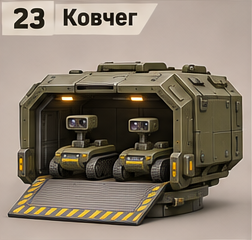
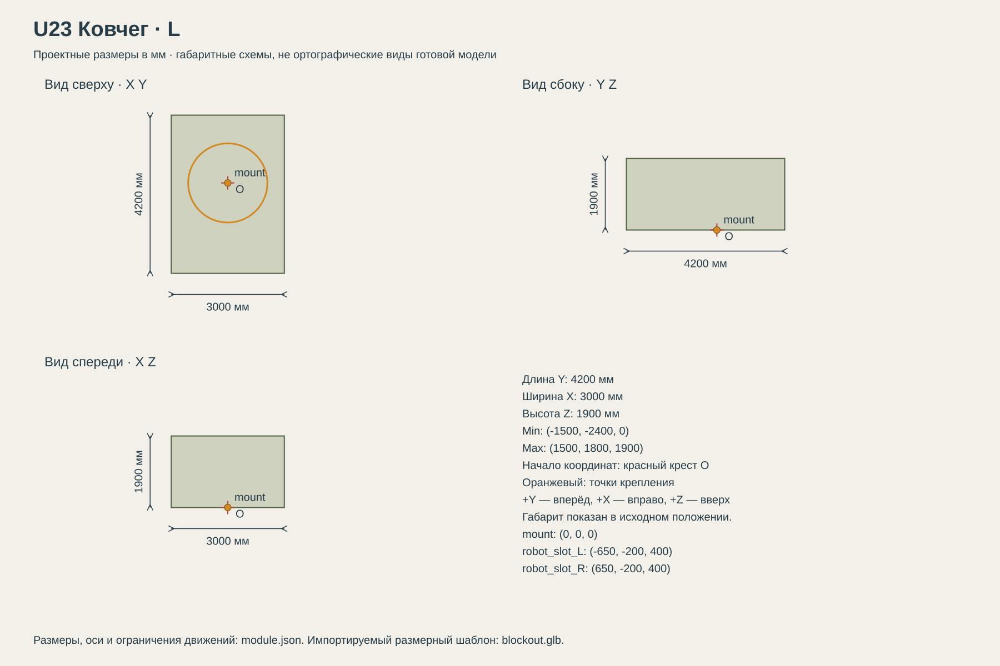

# U23 Ковчег

Доставка малых наземных роботов для разведки и вспомогательных задач.

## Размеры и крепления

**Размеры назначены для игры и обязательны для модели.** Концепт показывает внешний характер; численные размеры задаются здесь и в module.json, а не измеряются по пикселям.

| Параметр | Значение |
| --- | --- |
| Класс | L |
| Длина Y | 4200 мм |
| Ширина X | 3000 мм |
| Высота Z | 1900 мм |
| Min X Y Z | (-1500, -2400, 0) мм |
| Max X Y Z | (1500, 1800, 1900) мм |
| Оси | +X вправо, +Y вперёд, +Z вверх |
| Масштаб | 1000 мм = 1 м; GLB хранит метры |
| Начало координат | Центр нижней плоскости фланца; совпадает с upper_mount корпуса. |
| mount | (0, 0, 0) мм; нижняя плоскость фланца; yaw = 0 смотрит вдоль +Y |
| robot_slot_L | (-650, -200, 400) мм; опорная плоскость D02 |
| robot_slot_R | (650, -200, 400) мм; опорная плоскость D02 |
| Рабочая область Min X Y Z | (-1500, -16000, -4300) мм |
| Рабочая область Max X Y Z | (1500, 1800, 4000) мм |
| Рабочая область | Консервативный объём для движений, не сплошной меш и не коллайдер |
| Диаметр верхнего интерфейса | 2100 мм |
| Высота фланца верхнего модуля | 120 мм над его нулевой плоскостью |

[Открыть размерную заготовку GLB](blockout.glb). Это габаритный объём и пустые узлы креплений/движений; художественной геометрии и готовых анимаций в нём нет.

## Внешний вид

Грузовой контейнер, два робота с камерами внутри и раскрытая аппарель.

## Подвижные части

Все центры ниже заданы в координатах всего модуля при исходной позе, в мм. Оси вращения заданы в локальной системе родителя. Положительное вращение — по правилу правой руки.

| Узел | Родитель | Центр X Y Z мм | Движение | Пределы или скорость |
| --- | --- | --- | --- | --- |
| ramp_slide | корень модуля | (0, -2250, 350) | Выдвигает мост и шарнир аппарели за корму; неподвижная часть моста остаётся в носителе. | -2800…0 мм; скорость 1400; исходное 0 |
| ramp_hinge | ramp_slide | (0, -2250, 350) | 0: полотно направлено вперёд +Y внутри носителя. 215: назад и вниз под 35 градусов. | 0…215 градусов; скорость 107.5; исходное 0 |
| ramp_extend | ramp_hinge | (0, -2250, 350) | Удлинение вдоль локальной +Y полотна; 2500 мм базовой длины + 0…7500 мм выдвижения. | 0…7500 мм; скорость 1500; исходное 0 |

## Состояния и последовательность анимаций

- **Транспорт:** ramp_slide=0, ramp_hinge=0, ramp_extend=0. Полотно длиной 2500 мм лежит вперёд от Y=-2250 до +250 на Z=350, под уровнем роботов. В задней стенке есть постоянный открытый проём шириной 1400 мм и высотой 1400 мм над полом Z=350.
- **Подготовка:** Машина остановлена. Освободить кормовую зону. Сдвинуть мост с шарниром ramp_slide 0→-2800 мм за 2 с. Теперь шарнир Y=-5050, а весь поворачиваемый участок находится за кормой носителя.
- **Опускание:** Повернуть ramp_hinge 0→215° за 2 с через верхнюю свободную область. Конечный наклон полотна — 35° ниже горизонта назад. Нужна свободная высота до Z=4000 над сокетом U23.
- **Удлинение:** H = высота корня всей машины над землёй + body_mount.Z + upper_mount.Z + 350 мм. Длина = H/sin(35°). Допустимо 2500…10000 мм; ramp_extend = длина-2500. Выдвигать до касания поверхности, вне диапазона действие запрещено.
- **Выгрузка:** Скорость робота 500 мм/с. Выбранный робот сначала движется к Y=-1400, сохраняя X своего слота; затем перемещается к X=0, не задевая второго робота; затем едет назад по выдвинутому мосту и аппарели. Второй робот ждёт освобождения прохода. Низ гусениц следует поверхности.
- **Закрытие:** Убрать ramp_extend в 0, повернуть ramp_hinge в 0 за 2 с, затем ramp_slide в 0 за 2 с. Пока траектория занята роботом, закрытие запрещено.

## Светящиеся элементы

Цвета указаны в sRGB HEX. Strength — условная безразмерная сила Emission для художественного материала. Это не освещённость в люменах. Отдельные источники света не добавлять, если они не перечислены.

| Материал или узел | Центр X Y Z мм | Цвет | Strength | Когда работает |
| --- | --- | --- | --- | --- |
| status | (0, -2340, 180) | #75D58A | 1 | Дежурный режим: 0.25; работа: 1; неисправность: #FF6238, 1 Гц. Здоровый модуль не мигает. |

## Зазоры и ограничения

- Вся жёсткая геометрия в исходной позе находится внутри заданного габарита; кроме эффектов части не уходят ниже Z=0.
- Фланец: диаметр 2100 мм, высота 120 мм. Нижняя плоскость Z=0.
- Минимальный зазор движущихся твёрдых частей друг от друга — 30 мм. Рисунок не задаёт численную геометрию скрытой стороны.
- Ширина прохода аппарели 1200 мм; робот шириной 850 мм проходит один за раз.
- Сдвинутый шарнир находится за задней границей B05 и B10. Перед опусканием проверить весь рабочий объём позади машины. Роботы не телепортируются через закрытую стенку.
- Выдвижной мост перекрывает весь промежуток между носителем и сдвинутым шарниром; это отдельная видимая геометрия, не пустой зазор.
- Аппарель в транспортной позе лежит под роботами. Сначала выдвигается целиком, потом поворачивается; не открывать её внутри контейнера.

## Отдельные объекты

- [D02](../../payloads/D02-ground-scout/README.md): 2 экземпляров; Малый наземный разведывательный робот, отдельные экземпляры одной модели.
  - robot_slot_L: (-650, -200, 400) мм.
  - robot_slot_R: (650, -200, 400) мм.

## Файлы

- `reference.png` — отдельный фрагмент исходного концепта без перерисовки.
- `dimensions.svg` — три вида габаритного объёма в одном масштабе, с размерами и центрами креплений.
- `module.json` — источник размеров, узлов, состояний и подсветки.
- `blockout.glb` — размерный шаблон для импорта в 3D-редактор.

[Единый стандарт размеров](../../standards.md) · [Каталог](../../../README.md)
