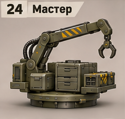
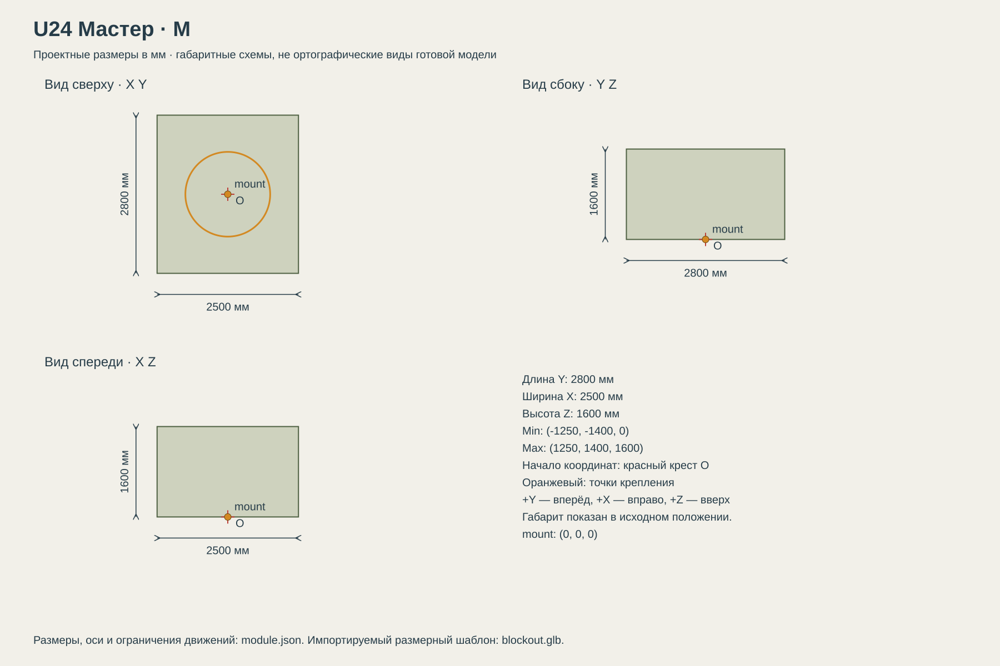

# U24 Мастер

Полевой ремонт союзной техники; машина поддержки, которой требуется прикрытие.

## Размеры и крепления

**Размеры назначены для игры и обязательны для модели.** Концепт показывает внешний характер; численные размеры задаются здесь и в module.json, а не измеряются по пикселям.

| Параметр | Значение |
| --- | --- |
| Класс | M |
| Длина Y | 2800 мм |
| Ширина X | 2500 мм |
| Высота Z | 1600 мм |
| Min X Y Z | (-1250, -1400, 0) мм |
| Max X Y Z | (1250, 1400, 1600) мм |
| Оси | +X вправо, +Y вперёд, +Z вверх |
| Масштаб | 1000 мм = 1 м; GLB хранит метры |
| Начало координат | Центр нижней плоскости фланца; совпадает с upper_mount корпуса. |
| mount | (0, 0, 0) мм; нижняя плоскость фланца; yaw = 0 смотрит вдоль +Y |
| Рабочая область Min X Y Z | (-4500, -4500, -2500) мм |
| Рабочая область Max X Y Z | (4500, 4500, 5200) мм |
| Рабочая область | Консервативный объём для движений, не сплошной меш и не коллайдер |
| Диаметр верхнего интерфейса | 1500 мм |
| Высота фланца верхнего модуля | 100 мм над его нулевой плоскостью |

[Открыть размерную заготовку GLB](blockout.glb). Это габаритный объём и пустые узлы креплений/движений; художественной геометрии и готовых анимаций в нём нет.

## Внешний вид

Складной манипулятор с захватом, инструментальные ящики и низкая круглая платформа.

## Подвижные части

Все центры ниже заданы в координатах всего модуля при исходной позе, в мм. Оси вращения заданы в локальной системе родителя. Положительное вращение — по правилу правой руки.

| Узел | Родитель | Центр X Y Z мм | Движение | Пределы или скорость |
| --- | --- | --- | --- | --- |
| turret_yaw | корень модуля | (0, 0, 100) | rotation по Z. Вращается вся установка над неподвижным фланцем. | непрерывное вращение; 35 град/с |
| boom_lift | turret_yaw | (0, 0, 650) | rotation по X.  | -15…75 градусов; исходное 0; 25 град/с |
| elbow | boom_lift | (0, -650, 1100) | rotation по X.  | -110…30 градусов; исходное 0; 35 град/с |
| boom_extend | elbow | (0, -900, 1200) | translation по Y.  | -2200…0 мм; исходное 0; 1100 мм/с |
| gripper_yaw | boom_extend | (0, -1100, 1000) | rotation по Z.  | -180…180 градусов; исходное 0; 60 град/с |
| gripper_L | gripper_yaw | (-90, -1100, 900) | rotation по Y.  | -30…0 градусов; исходное 0; 60 град/с |
| gripper_R | gripper_yaw | (90, -1100, 900) | rotation по Y.  | 0…30 градусов; исходное 0; 60 град/с |

## Состояния и последовательность анимаций

- **Транспорт:** Все относительные углы и выдвижение 0; манипулятор сложен внутрь исходного габарита.
- **Развёртывание:** Поднять boom_lift до 45 за 1.8 с, разогнуть elbow до -60 за 1.7 с, затем разрешить yaw и выдвижение.
- **Ремонт:** Достигать цели в рабочем объёме через IK, не превышая пределов суставов. Захват раскрывается до -30/+30 за 0.5 с. Опускать захват ниже крыши только снаружи общего габарита машины; не ниже земли.
- **Сворачивание:** Убрать boom_extend, привести yaw и захват в 0, затем сложить локоть и основание в исходную позу. Машина едет только после завершения.

## Светящиеся элементы

Цвета указаны в sRGB HEX. Strength — условная безразмерная сила Emission для художественного материала. Это не освещённость в люменах. Отдельные источники света не добавлять, если они не перечислены.

| Материал или узел | Центр X Y Z мм | Цвет | Strength | Когда работает |
| --- | --- | --- | --- | --- |
| status | (0, -1340, 180) | #75D58A | 1 | Дежурный режим: 0.25; работа: 1; неисправность: #FF6238, 1 Гц. Здоровый модуль не мигает. |
| work_lamp | (0, -1100, 1100) | #FFF0D0 | 2 | Включена только при ремонте; следует концу стрелы. |

## Зазоры и ограничения

- Вся жёсткая геометрия в исходной позе находится внутри заданного габарита; кроме эффектов части не уходят ниже Z=0.
- Фланец: диаметр 1500 мм, высота 100 мм. Нижняя плоскость Z=0.
- Минимальный зазор движущихся твёрдых частей друг от друга — 30 мм. Рисунок не задаёт численную геометрию скрытой стороны.

## Файлы

- `reference.png` — отдельный фрагмент исходного концепта без перерисовки.
- `dimensions.svg` — три вида габаритного объёма в одном масштабе, с размерами и центрами креплений.
- `module.json` — источник размеров, узлов, состояний и подсветки.
- `blockout.glb` — размерный шаблон для импорта в 3D-редактор.

[Единый стандарт размеров](../../standards.md) · [Каталог](../../../README.md)
